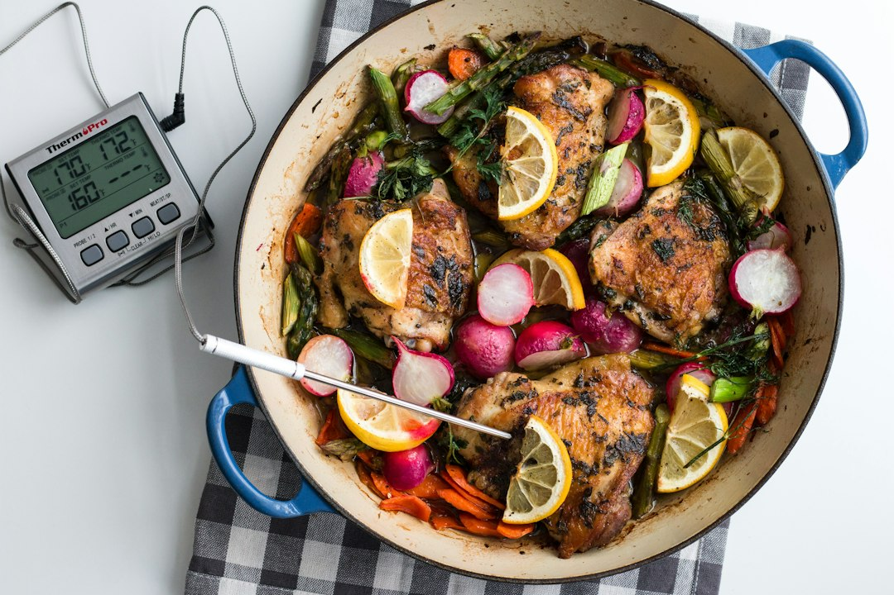

*Photo by [ThermoPro](https://unsplash.com/@thermopro) on [Unsplash](https://unsplash.com)*

If you've ever cut into a chicken breast only to find it's still pink in the middle, or pulled a steak off the grill that turned into shoe leather by the time you plated it, you already know the problem. Guessing at doneness is how good cuts of meat go to waste.

The fix isn't a fancy culinary degree. It's a decent thermometer, and you don't need to spend $150 to get three that actually works. These three options cover the full range, from a $15 instant-read basic to a wireless smart probe that practically babysits your roast for you.

By the end of this, you'll know exactly which one fits how you actually cook, not just what's trending on a gadget blog.

## Quick Picks

- **Best overall value:** Meat Thermometer Digital Instant Read: fast, accurate, no subscription or app required
- **Best for grilling and smoking:** TempPro TempSpike 500 ft Wireless: leave the grill, keep the data
- **Best smart upgrade:** MEATER SE Wireless Smart Thermometer: dual sensors track meat and ambient heat together

## Comparison Table

| Product | Best For | Capacity | Key Perk |
|---|---|---|---|
| Meat Thermometer Digital Instant Read | Quick checks, everyday cooking | Single probe | Reads in 2-3 seconds |
| TempPro TempSpike 500 ft Wireless | Long smokes, backyard grilling | Single probe, multi-unit capable | 500 ft Bluetooth 5.2 range |
| MEATER SE Wireless Smart Thermometer | Oven roasting, reverse searing | Dual sensor (meat + ambient) | Tracks ambient temp up to 527°F |

## How We Picked These

We looked at three things: accuracy, speed, and whether a thermometer actually fits how home cooks work, not professional kitchens. Price under $50 was non-negotiable, since you shouldn't need to mortgage dinner to know when it's done. We also factored in battery life, probe durability, and whether the tech (Bluetooth, apps) adds real value or just complexity you'll abandon after week two.

## The Best Meat Thermometers Under $50

### Meat Thermometer Digital Instant Read

This is the thermometer you grab when you just need an answer fast. No pairing, no charging, no app download: just a probe, a button, and a readout in about 2-3 seconds. It's the one I'd hand to someone who's never used a thermometer before and needs it to work on the first try.

**Best for:** home cooks who want a reliable tool without any learning curve

**Pros:**
- Reads temperature in 2-3 seconds flat, so you're not standing over the pan guessing
- Foldable probe design means it won't stab you digging through a drawer
- Simple enough that there's genuinely nothing to figure out: one button, one job

**Cons:**
- No remote monitoring, so you have to be standing at the stove to check it
- Not built for long unattended cooks like smoking a brisket overnight

[→ Check price on Amazon](https://www.amazon.com/dp/B0HMHNX2HB?tag=merrieri0a-20)

### TempPro TempSpike 500 ft Wireless Meat Thermometer

If you grill or smoke regularly, this solves the single most annoying part of the process: standing next to a hot grill for four hours because you're afraid to walk away. The 500 ft Bluetooth 5.2 range means you can go inside, mow the lawn, or ignore the thing on the porch while it tracks your food.

**Best for:** weekend grillers and smokers who want to leave the yard without leaving the food unattended

**Pros:**
- 500 ft range means you can monitor from inside the house, not just from the patio
- Bluetooth 5.2 connection holds steady, no random drops like older wireless probes
- Handles longer cooks like ribs or pork shoulder well, not just quick sears

**Cons:**
- Requires charging the probe between uses, which is easy to forget until you need it
- App setup takes a few extra minutes compared to the instant-read option

[→ Check price on Amazon](https://www.amazon.com/dp/B0B48NL6L8?tag=merrieri0a-20)

### MEATER SE Wireless Smart Meat Thermometer

This is the thermometer for people who want data, not just a number. The dual sensors track internal meat temperature up to 212°F and ambient cooking temperature up to 527°F at the same time, so you can see how hot your oven or grill is actually running instead of assuming. That's genuinely useful for reverse-searing a roast or dialing in a smoker that tends to run hot.

**Best for:** home cooks who roast or reverse-sear and want to monitor both the meat and the cooking environment at once

**Pros:**
- Dual sensor setup means one probe does the job of two separate thermometers
- Ambient temp tracking up to 527°F works across ovens, grills, and smokers
- App gives guided cook estimates, handy if you're still learning doneness targets by feel

**Cons:**
- Wireless range is shorter than the TempSpike, so it's less ideal if you wander far from the kitchen
- Probe needs careful hand cleaning since it's not fully submersible like basic models

[→ Check price on Amazon](https://www.amazon.com/dp/B0D2LQGJ2V?tag=merrieri0a-20)

## What to Skip

- **Thermometers with no calibration option.** If you can't verify accuracy against boiling or ice water, you're trusting a guess dressed up as data.
- **Analog dial thermometers for quick checks.** They're slow to respond and often off by several degrees, which matters more than people think on thin cuts.
- **Apps that require constant Wi-Fi or account creation just to read a temperature.** If the basic function is locked behind a login, that's a red flag for reliability.

## Frequently Asked Questions

**What temperature should a meat thermometer read for chicken?**
Chicken is safe at 165°F internal temperature, measured at the thickest part of the breast or thigh, avoiding bone.

**Are instant-read thermometers accurate enough for grilling?**
Yes, for spot-checks they're accurate and fast. For long cooks like smoking, a wireless probe that monitors continuously is more practical since you're not opening the lid repeatedly.

**Do I need a wireless meat thermometer, or is instant-read enough?**
If you mostly sear steaks or check a roast once or twice, instant-read covers you. If you smoke, grill low and slow, or want to step away from the kitchen during a cook, wireless is worth the upgrade.

## The Bottom Line

All three of these thermometers do the core job well: they tell you when your food is actually done, not just when it looks done. If you want simple and fast, grab the instant-read. If you're serious about grilling or smoking, the TempSpike or MEATER SE will earn their keep fast, and either one still comes in under $50.

---

## Related Articles

- [Best Herb Stripper for Fresh Herbs Under $15 in 2026: Top Picks for Every Kitchen](https://kitchen-finds.com/2026/10/30/best-herb-stripper-for-fresh-herbs-under-15-in-2026-top-picks-for-every-kitchen/)
- [Best Pasta Maker Tool for Fresh Noodles Under $45 in 2026: Top Picks for Home Cooks](https://kitchen-finds.com/2026/10/28/best-pasta-maker-tool-for-fresh-noodles-under-45-in-2026-top-picks-for-home-cooks/)
- [5 Best Garlic Press That Actually Works Under $20 (Tested Picks)](https://kitchen-finds.com/2026/10/26/best-garlic-press-that-actually-works-under-20/)