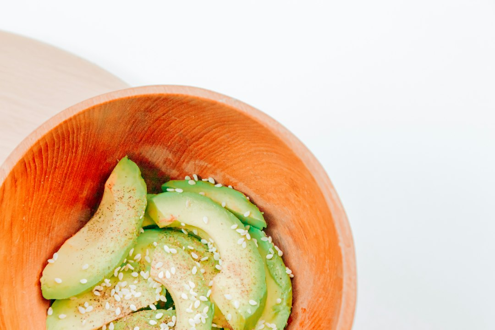

*Photo by [Diana Polekhina](https://unsplash.com/@diana_pole) on [Unsplash](https://unsplash.com)*

Avocado toast isn't going anywhere, and neither is the annual trip to the ER for knife-related avocado injuries. Seriously, "avocado hand" is a real term doctors use. The fix is cheap, small, and sitting in a kitchen drawer near you for less than the price of a fancy coffee.

If you're hunting for the best avocado slicer and pit remover under $12, you're in the right place. We tested the gadgets, skipped the gimmicks, and kept only the tools that actually earn a spot in your utensil drawer.

## Why You Need a Dedicated Avocado Slicer and Pit Remover

A chef's knife is great for a lot of things. Slicing a slippery, round avocado with an unforgiving pit inside isn't one of them. Here's why a dedicated tool beats winging it with cutlery.

### Benefits of using specialized tools versus knives

A good avocado tool is shaped to match the fruit. The curved blade follows the contour of the skin, the slicer cuts even strips without mashing the flesh, and the pit remover grabs the seed without you having to whack a knife into it and twist. You get cleaner cuts, less waste, and a tool that does one job really well instead of a knife doing five jobs okay.

### Safety advantages for home cooks

Here's the uncomfortable truth: most avocado-related knife injuries happen because people stab a knife into the pit and it slips. That knife is sharp, your hand is wrapped around a slick avocado, and things go wrong fast. A dedicated pit remover has a dull, scoop-style edge designed to pop the pit out with a twist, not a stab. No blade anywhere near your palm.

### Cost-effectiveness compared to replacing damaged knives

Using your good chef's knife on avocado pits, especially the thick-skinned ones, dulls the edge faster than you'd think. Whacking a blade into a hard pit repeatedly isn't great for the steel either. A $10 avocado tool protects your knife investment and saves you a trip to get it professionally sharpened.

### How proper tools extend avocado freshness

A clean cut matters more than people realize. Jagged, knife-mangled avocado flesh browns faster because more surface area is exposed and torn. A smooth slice from a proper tool keeps more of the cell structure intact, which slows oxidation. Translation: your guac stays greener longer.

## Key Features to Look For in Budget Avocado Tools

Not every cheap tool is a good cheap tool. Here's what actually matters when you're shopping under $12.

### Blade quality and sharpness retention

Look for stainless steel blades, even on budget tools. Stainless resists rust, holds an edge longer, and won't react with the avocado's acidity. Cheap coated metal blades tend to chip or dull within a few months. Stainless steel costs the manufacturer almost nothing extra, so there's no excuse for a tool under $12 to skip it.

### Handle ergonomics and comfort

You're gripping this thing with a wet or oily hand, so the handle needs texture. Nylon and silicone-accented grips beat smooth plastic every time. Look for a handle with some curve or contour that matches how your hand naturally closes around it.

### Safety guard designs and effectiveness

The best budget slicers have a rounded tip or blunt edge on the slicing blade so you're not working with something as sharp as a utility knife. Pit removers should have smooth, rounded scoop edges, not sharp points. If a product photo shows a pointy metal spike marketed as a "pit remover," skip it.

### Material durability under $12 price point

At this price, you're choosing between food-grade plastic, nylon, and stainless steel, sometimes all three in one tool. Stainless steel blades with nylon or plastic handles tend to last the longest without cracking or warping. Pure plastic tools can work fine for occasional use but wear out faster if you're making guac every week.

### Ease of cleaning and maintenance

One-piece or simple two-piece designs win here. Anything with tiny crevices, springs, or multiple moving parts traps avocado residue and gets gross fast. Dishwasher-safe stainless and nylon combos are your best bet for quick cleanup.

## Top Avocado Slicers and Pit Removers Under $12

We rounded up the standout options across different styles, so whether you want an all-in-one gadget or a simple single-purpose tool, there's something here.

### Three-in-one stainless steel avocado tool

If you only buy one avocado gadget, make it this one. A <a href="https://www.amazon.com/s?k=three-in-one%20stainless%20steel%20avocado%20tool&tag=merrieri0a-20" data-inline>three-in-one stainless steel avocado tool</a> typically combines a splitter blade, a pit-removing scoop, and a fan-style slicer in a single handle. You split the avocado, twist out the pit, then drag the slicer blade through the flesh for even strips, no extra tools needed. It's the most efficient option for anyone who eats avocado regularly and wants one gadget to do it all.

### Two-piece pit remover and slicer sets

Prefer separate tools instead of one multi-tasker? A <a href="https://www.amazon.com/s?k=two-piece%20pit%20and%20slice%20set&tag=merrieri0a-20" data-inline>two-piece pit and slice set</a> gives you a dedicated pitter and a dedicated slicer, each optimized for its single job. Some people find separate tools easier to control since you're not switching grip mid-task. These sets also tend to be more compact individually, which makes them easier to store in a drawer divider.

### Ergonomic single-function pit removers

Sometimes you just need the pit out, fast, without extra bells and whistles. An <a href="https://www.amazon.com/s?k=ergonomic%20pit%20remover%20scoop&tag=merrieri0a-20" data-inline>ergonomic pit remover scoop</a> is built purely for that one job: a curved handle, a rounded scoop tip, and enough leverage to pop a stubborn pit without digging your fingers in. These are great as a backup tool or if you already have a knife you trust for slicing but hate dealing with pits.

### Integrated slicing and pitting gadgets

A <a href="https://www.amazon.com/s?k=dual-sided%20slicer%20and%20pit%20remover&tag=merrieri0a-20" data-inline>dual-sided slicer and pit remover</a> puts the slicer on one end and the pitter on the other end of a single handle. You flip the tool instead of swapping between two separate gadgets. It's a nice middle ground between a bulky three-in-one and a bare-bones single-function scoop.

### Compact travel-friendly options

Meal preppers and lunchbox packers, this one's for you. A <a href="https://www.amazon.com/s?k=compact%20travel%20avocado%20gadget&tag=merrieri0a-20" data-inline>compact travel avocado gadget</a> folds down small enough to toss in a bag or lunch cooler. It won't replace your main kitchen tool, but it's genuinely useful if you're prepping avocado toast at the office or slicing one on a camping trip.

Two more worth mentioning: a <a href="https://www.amazon.com/s?k=silicone%20grip%20avocado%20corer&tag=merrieri0a-20" data-inline>silicone grip avocado corer</a> is a solid pick if slippery handles are your main complaint with cheap tools, since the silicone grip stays put even when your hands are oily. And a <a href="https://www.amazon.com/s?k=nylon-handled%20avocado%20pitter&tag=merrieri0a-20" data-inline>nylon-handled avocado pitter</a> is a durable, dishwasher-friendly option that holds up well to repeated use without the handle cracking like some all-plastic versions do.

## How to Use Avocado Tools Safely and Effectively

Owning the right tool only helps if you're using it correctly. Here's how to actually get clean, safe results every time.

### Proper grip and hand positioning techniques

Always cup the avocado in your non-dominant hand with your palm supporting the bottom, fingers curled away from the cutting path. Never hold the avocado flat in your palm with fingers wrapped around the side where a blade will pass. Keep your tool hand steady and let the blade do the work instead of pressing hard.

### Step-by-step instructions for pitting and slicing

1. Cut the avocado in half lengthwise around the pit using the splitter blade or a knife.
2. Twist the two halves apart.
3. For the half with the pit, press the pit remover scoop down onto the pit at a slight angle, twist, and lift to pop it out.
4. Score the flesh in the shell using the slicer blade, dragging it through in one smooth motion.
5. Scoop the slices out with a spoon or flip the skin inside out to pop the slices free.

### Common mistakes that waste fruit or risk injury

The biggest mistake is stabbing a knife straight into the pit. It's unnecessary with a proper tool and it's the number one cause of avocado-related cuts. Another common error is slicing before the avocado is ripe enough, which tears the flesh instead of cutting cleanly. And don't forget to clean the blade between avocados if you're prepping several, since residue builds up and makes slicing messier.

### Tips for handling slippery avocados

Ripe avocados can be slick, especially once the skin is off. A damp kitchen towel under your cutting board stops the board from sliding, and a textured or silicone-gripped tool handle keeps your grip steady even with oily fingers. If you're prepping a lot of avocados at once, consider pairing your slicer with a good [vegetable chopper](https://kitchen-finds.com/2026/10/21/best-vegetable-chopper-for-quick-prep-under-25-in-2026-top-rated-tools-reviewed/) for dicing onions, tomatoes, and peppers alongside your guac ingredients.

### Storage and care best practices

Hand wash stainless steel blades and dry immediately to prevent water spots. Store the tool in a drawer, not loose in a bin with heavier utensils that could dull or bend the blade. If you're organizing your prep tools, a dedicated drawer tray keeps your avocado gadget, [wooden spoons](https://kitchen-finds.com/2026/10/23/best-wooden-spoon-sets-that-won-t-scratch-under-18-in-2026/), and other small tools from banging into each other every time you open the drawer.

## Comparing Avocado Tools: Slicer vs. Pit Remover vs. Combo Tools

Not sure which style fits your kitchen? Here's how to decide.

### When to choose single-function tools

If you already have a reliable way to slice avocados, like a sharp paring knife, but just hate dealing with the pit, a standalone pit remover is all you need. Single-function tools also tend to be sturdier since there's only one job to engineer around, and they're easier to clean because there's less going on mechanically.

### Advantages of multi-purpose gadgets

Combo tools save drawer space and mean you never have to hunt for a second gadget mid-prep. For people who eat avocado often, like daily toast or weekly guac nights, a three-in-one tool is usually worth it. You get consistent results every time without having to think about technique.

### Space and storage considerations

If your kitchen drawers are already packed, a single multi-tool beats owning three separate gadgets. If you have room and prefer specialized tools that do one job perfectly, a two-piece set gives you that without much extra bulk.

### Value for money analysis

Dollar for dollar, three-in-one tools usually win on value since you're getting three functions for one low price. But if the slicer function on a combo tool feels flimsy, a quality standalone pit remover paired with a sharp knife might actually outperform a mediocre all-in-one. Read reviews carefully and don't assume more functions always means more value.

## Where to Buy the Best Deals on Avocado Tools Under $12

### Online retailers with competitive pricing

Amazon is the easiest place to compare avocado tools side by side, check reviews, and find options that ship fast with Prime. Prices on these tools rarely swing wildly, but checking a few listings before buying helps you spot the best-rated option in your price range.

### Seasonal sales and discount opportunities

Watch for kitchen gadget deals around major shopping events like Prime Day, Black Friday, and New Year's resolution season in January, when healthy eating tools get discounted. Avocado tools are small enough that they often get bundled into multi-buy deals too.

### Subscription box options

Some kitchen gadget subscription boxes include small prep tools like avocado slicers as filler items. These aren't the most reliable way to get a specific tool, but they're worth it if you're already subscribed for other reasons.

### Quality guarantees and return policies

Stick to sellers with clear return windows. Most reputable kitchen brands on Amazon offer at least 30 days for returns, which matters if a blade arrives dull or a handle feels flimsy out of the box.

### Bulk buying for families or meal prep enthusiasts

If you're stocking a shared household kitchen or a meal prep service, buying two or three of the same tool means you're never waiting for someone to finish with the only pitter in the house. At under $12 each, buying a couple of backups still costs less than most single kitchen gadgets.

## FAQ: Common Questions About Avocado Slicers and Pit Removers

**What's the difference between an avocado slicer and a pit remover?**

A slicer cuts the flesh into even strips while it's still in the skin. A pit remover is a scoop-shaped tool that grips and pulls out the pit without a knife. Combo tools include both functions in one handle, while standalone tools only do one job each.

**Can I use a regular knife instead of an avocado tool?**

You can, but it's riskier and less precise. Knives are sharp enough to cause serious cuts if they slip on the pit or skin, and they don't match the avocado's curve the way a dedicated slicer does. A $10 tool is a small price for better safety and cleaner cuts.

**How do I remove the pit safely with a pit remover?**

Press the scoop end of the tool down onto the pit at a slight angle, not straight on. Twist gently while applying light downward pressure, then lift. The pit should pop free without needing to pry or force it.

**Are stainless steel avocado tools dishwasher safe?**

Most are, but check the specific product listing first. Stainless steel blades generally hold up fine in the dishwasher, but nylon or plastic handles can warp over time with repeated heat exposure. Hand washing extends the life of any budget tool, dishwasher-safe or not.

**How long do budget avocado tools typically last?**

A decent stainless steel tool under $12 should last one to two years with regular use, as long as you hand wash it and avoid using it on anything harder than an avocado pit. Cheaper all-plastic versions may wear out faster, especially the blade edge.

Whatever style you land on, whether it's the all-in-one three-in-one tool or a simple scoop-style pitter, grabbing the best avocado slicer and pit remover under $12 means faster prep, fewer wasted avocados, and zero trips to urgent care. That's a win for your toast and your fingers.

## Related Articles

- [Best Herb Stripper for Fresh Herbs Under $15 in 2026: Top Picks for Every Kitchen](https://kitchen-finds.com/2026/10/30/best-herb-stripper-for-fresh-herbs-under-15-in-2026-top-picks-for-every-kitchen/)
- [Best Pasta Maker Tool for Fresh Noodles Under $45 in 2026: Top Picks for Home Cooks](https://kitchen-finds.com/2026/10/28/best-pasta-maker-tool-for-fresh-noodles-under-45-in-2026-top-picks-for-home-cooks/)
- [Best Wooden Spoon Sets That Won't Scratch Under $18 in 2026](https://kitchen-finds.com/2026/10/23/best-wooden-spoon-sets-that-won-t-scratch-under-18-in-2026/)
