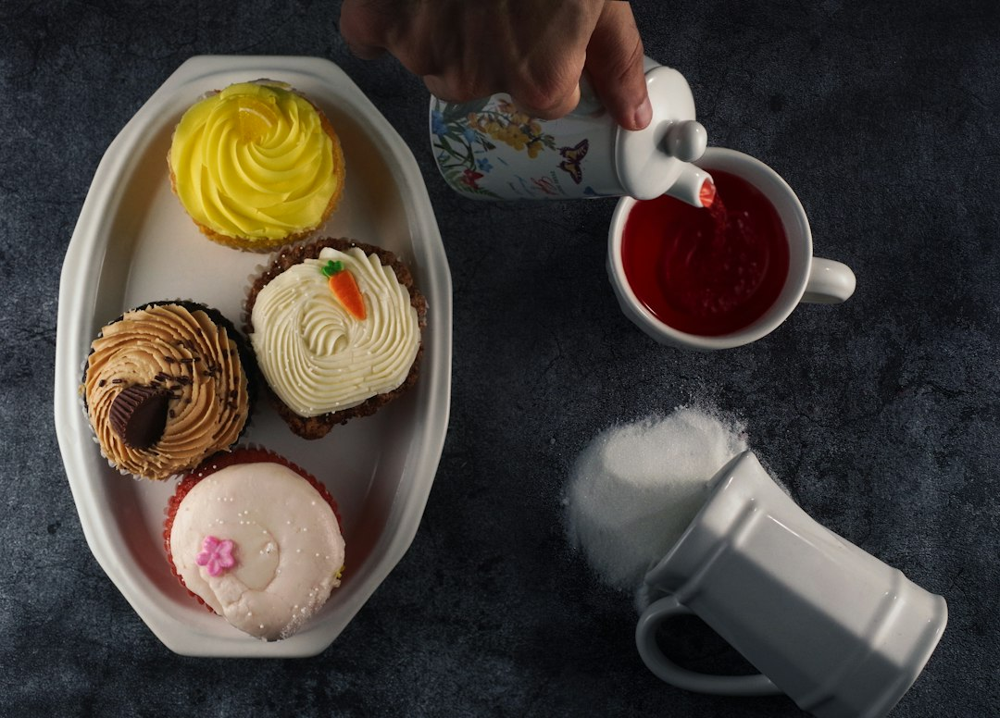

*Photo by [Saman Taheri](https://unsplash.com/@libraryofsamael) on [Unsplash](https://unsplash.com)*

Your fridge door is a mess of half-empty bottles. Ketchup that won't pour. Mustard caked around the cap. Sauce you made from scratch sitting in a mason jar because you had nowhere else to put it. Silicone squeeze bottles fix all of that, and they cost less than a pizza delivery.

Here's everything you need to know before you buy, plus the exact bottles worth your money.

## Why Silicone Squeeze Bottles Are Game-Changers for Your Kitchen

Plastic squeeze bottles crack. Glass ones shatter if you drop them on tile. Silicone just bends and bounces back. That flexibility is the whole point. You can squeeze from any angle, get every last drop out, and never worry about a hairline fracture ruining your countertop.

Silicone also doesn't hold onto smells the way cheap plastic does. Food-grade silicone is non-porous when it's made correctly, so your honey bottle won't start smelling like last week's sriracha. That matters more than people realize until they've opened a plastic bottle and gotten a whiff of old barbecue sauce mixed with new maple syrup.

Durability is the other big win. A decent silicone bottle will outlast three or four plastic ones. It handles drops, squishes back into shape after storage, and doesn't yellow or get brittle the way plastic does after a year of dishwasher cycles. You're not replacing these every few months.

Temperature resistance is where silicone really separates itself. Most food-grade silicone handles temperatures from well below freezing up to 400°F or higher, depending on the grade. That means you can fill a bottle with warm caramel sauce or melted butter without worrying about warping or leaching chemicals into your food. Glass can shatter with sudden temperature changes. Plastic can warp or release odors when it gets warm. Silicone just handles it.

And the price point matters. You don't need to spend $40 on a fancy condiment dispenser set to get this upgrade. The best silicone squeeze bottles for condiments under $20 give you restaurant-quality control for less than the cost of a nice bottle of wine. That's what makes this such an easy swap for almost any kitchen, whether you're meal prepping, grilling, or just tired of fighting with a ketchup bottle that won't cooperate.

## Key Features to Look For When Choosing Silicone Squeeze Bottles

Not every silicone bottle is created equal. Here's what actually matters when you're comparing options.

**Nozzle design** is the first thing to check. A narrow, precision tip gives you thin lines for drizzling sauces over plated food. A wider nozzle is better for thicker condiments like ketchup or mayo that would clog a narrow opening. Some bottles come with interchangeable tips, which gives you flexibility without buying multiple bottles.

**Capacity** depends on what you're storing and how often you refill. Smaller 8-ounce bottles are great for portability or single-use condiments like salad dressing you're taking to work. Larger 16 to 20-ounce bottles make more sense for high-use items like olive oil or homemade sauces you go through fast. Think about your fridge door space too. Bottles that are too tall won't fit, and that defeats the purpose.

**Cleaning ease** matters more than people expect. Wide-mouth designs let you get a brush or your hand inside to scrub properly. Dishwasher-safe silicone saves you time, but double check the label because some cheaper silicone blends aren't rated for high heat dishwasher cycles. If a bottle isn't dishwasher safe, you're stuck hand washing every single refill, which gets old fast.

**Material thickness** affects both durability and control. Too thin and the bottle feels flimsy, squeezes unevenly, or tears over time. Too thick and you lose the soft squeeze that makes these bottles so useful in the first place. Good silicone has some give but holds its shape when empty.

**Leak-proof sealing** is non-negotiable. A loose cap means condiment all over your pantry shelf or diaper bag if you're packing lunches. Look for bottles with a secure flip-top or locking mechanism, not just a simple snap cap that can pop open under pressure.

## Best Budget-Friendly Silicone Squeeze Bottles Under $20

Here's where the specifics come in. These categories cover different needs, and most options in each category land comfortably under that $20 mark.

**Collapsible bottles for storage efficiency** are a smart pick if cabinet space is tight. These squeeze down as you use the contents, so they don't take up full-size space when they're half empty. The <a href="https://www.amazon.com/s?k=Collapsible%20silicone%20squeeze%20bottles%20with%20flip-top%20caps&tag=merrieri0a-20" data-inline>Collapsible silicone squeeze bottles with flip-top caps</a> are a solid example. They work well for oils, dressings, and sauces you use daily, and they fold flat enough to toss in a cooler or travel bag without taking up much room.

**Wide-mouth bottles** solve the biggest annoyance with squeeze bottles: filling them. Trying to pour thick sauce into a narrow-neck bottle is a recipe for a sticky countertop. Wide-mouth designs let you spoon ingredients in directly, which is huge for homemade sauces, nut butters, or anything with chunks. The <a href="https://www.amazon.com/s?k=Wide-mouth%20silicone%20condiment%20bottles%20with%20measurement%20lines&tag=merrieri0a-20" data-inline>Wide-mouth silicone condiment bottles with measurement lines</a> add another layer of usefulness with printed measurement markings, so you can portion out dressing or sauce without pulling out a measuring cup.

**Narrow-tip bottles** are built for control. If you're drizzling balsamic glaze over a salad or doing fine detail work with chocolate sauce, you need a tip that gives you a thin, consistent line. The <a href="https://www.amazon.com/s?k=Precision-tip%20silicone%20squeeze%20bottles%20for%20thin%20sauces&tag=merrieri0a-20" data-inline>Precision-tip silicone squeeze bottles for thin sauces</a> are designed exactly for this. They're the bottles that make your food look like it came from a restaurant kitchen instead of a home one.

**Multi-pack sets** are the best value if you're outfitting your whole fridge at once. Buying bottles one at a time adds up, and a set gives you consistency across your condiments so everything looks organized. The <a href="https://www.amazon.com/s?k=Multi-pack%20silicone%20squeeze%20bottle%20sets%20%283-5%20bottles%29&tag=merrieri0a-20" data-inline>Multi-pack silicone squeeze bottle sets (3-5 bottles)</a> option is popular for exactly this reason. You can label each bottle for a specific condiment and never mix up your soy sauce and your simple syrup again.

**Graduated measurement markings** aren't just a nice-to-have if you bake or cook with any precision. Pancake batter, salad dressing recipes, and homemade marinades often call for specific amounts, and a bottle with printed lines means one less dish to wash. The wide-mouth option mentioned above covers this well, but it's worth checking any bottle you're considering for this feature before buying if it matters to your routine.

**Heat-resistant bottles** are a must if you're storing anything that goes in warm, like melted butter, warm caramel, or hot sauce straight off the stove. Regular silicone can handle moderate warmth, but bottles specifically rated for higher heat give you peace of mind that you won't warp the material or compromise the seal. The <a href="https://www.amazon.com/s?k=Heat-resistant%20silicone%20squeeze%20bottles%20for%20hot%20condiments&tag=merrieri0a-20" data-inline>Heat-resistant silicone squeeze bottles for hot condiments</a> are built for this exact use case, so you can pour hot contents in without waiting for everything to cool to room temperature first.

Across every category, the best silicone squeeze bottles for condiments under $20 share a few things in common: solid seals, food-grade material, and a design that matches how you actually cook. Figure out your top one or two use cases and pick based on that instead of trying to find one bottle that does everything.

## How to Use and Maintain Your Silicone Squeeze Bottles

Getting a good bottle is half the job. Using it right is the other half.

**Fill to the fill line, not the brim.** Overfilling makes it harder to squeeze evenly and increases the chance of the cap popping under pressure. Most bottles have a max fill line printed or molded into the body. Respect it, especially with thicker sauces that expand slightly when shaken or warmed.

**Match the condiment to the bottle type.** Thin liquids like vinaigrettes or soy sauce work great in narrow-tip bottles. Thicker stuff like ketchup, mustard, or homemade aioli needs a wider opening so it doesn't get stuck halfway through the neck. If you're storing something with solid pieces, like a chunky salsa or relish, size up to a wide-mouth design or skip the squeeze bottle altogether for that item.

**Clean with warm soapy water and a bottle brush**, even if the bottle is dishwasher safe. The inside of the neck is where buildup happens fastest, especially with sugary condiments like honey or syrup. A long, thin bottle brush gets into spots your fingers can't reach. If you're using the dishwasher, remove the cap and tip separately so water actually reaches every surface.

**Prevent odor absorption by rinsing immediately after use**, not after the bottle sits dirty for a day. Letting condiment residue dry inside the bottle makes it much harder to clean later and increases the chance of lingering smell. A quick rinse right after squeezing out what you need takes ten seconds and saves you a scrubbing session later.

**Dry bottles fully before storing them**, especially if you're using the collapsible style. Trapped moisture in a folded, collapsed bottle is a breeding ground for mildew. Turn bottles upside down on a drying rack or leave the cap off for a few hours before tucking them away.

**Replace bottles when the silicone starts to feel sticky, discolored, or loses its shape.** Good silicone should last well over a year with regular use, but no material lasts forever. If you notice a permanent odor that won't go away even after a deep clean, or if the material feels tacky instead of smooth, it's time to swap it out. At this price point, replacing one bottle every year or two is a minor cost for the convenience you get daily.

## Silicone Squeeze Bottles vs. Other Container Options

Plastic bottles are cheaper upfront but wear out fast. They crack under pressure, discolor over time, and often retain smells no matter how many times you wash them. You'll likely replace a plastic bottle two or three times in the span it takes one silicone bottle to wear out.

Glass is a different story. It's great for not absorbing smells and it looks nice on a shelf, but glass squeeze bottles are rare for a reason. Glass doesn't flex, so you lose the "squeeze" part of squeeze bottle entirely, and dropping a full glass bottle on a tile floor is a mess nobody wants to deal with. Glass makes more sense for storage jars than for active condiment dispensers.

Cost-wise, silicone wins over time even though the individual purchase price might be similar to plastic. Because silicone bottles last longer and don't need replacing as often, you spend less across a year or two of regular kitchen use. A $15 silicone bottle that lasts two years beats three $5 plastic bottles that each die after six months.

Environmentally, silicone is a better long-term choice too. It doesn't break down into microplastics the way degrading plastic bottles can, and because it lasts so much longer, you're sending less waste to the landfill overall. Some brands now make their silicone bottles from recycled or eco-conscious materials specifically. The <a href="https://www.amazon.com/s?k=Eco-friendly%20collapsible%20silicone%20storage%20squeeze%20bottles&tag=merrieri0a-20" data-inline>Eco-friendly collapsible silicone storage squeeze bottles</a> option is worth a look if sustainability is part of your buying decision, since it combines the collapsible space-saving design with a lower environmental footprint.

Aesthetically, silicone bottles just look more intentional in a kitchen. A row of matching silicone bottles with labels looks organized and deliberate, the kind of thing that makes your fridge door or pantry shelf look like it belongs in a cooking magazine instead of a chaotic mess of mismatched brand bottles. If kitchen organization is a priority for you, pairing these with other upgrades like a solid [vegetable chopper](https://kitchen-finds.com/2026/10/21/best-vegetable-chopper-for-quick-prep-under-25-in-2026-top-rated-tools-reviewed/) or a reliable [kitchen timer](https://kitchen-finds.com/2026/10/16/best-kitchen-timer-with-actual-accuracy-under-20-in-2026-top-picks-for-reliable-cooking/) rounds out a kitchen that actually functions the way it looks.

## FAQ

**What condiments work best in silicone squeeze bottles?**
Thin to medium-thickness condiments work best: ketchup, mustard, mayo, hot sauce, salad dressings, honey, syrup, and homemade sauces like pesto or chimichurri (as long as they're strained of large chunks). Thick pastes or anything with big solid pieces, like chunky salsa, tend to clog even a wide-mouth bottle.

**Can silicone squeeze bottles withstand hot sauces and marinades?**
Most food-grade silicone handles warm liquids just fine, but for anything hot off the stove, go with a bottle specifically labeled heat-resistant. These are rated for higher temperatures and designed to keep their seal and shape even when filled with something straight from a saucepan.

**Are silicone squeeze bottles truly leak-proof?**
The good ones are, as long as the cap is properly closed and you're not overfilling past the max line. Locking flip-cap designs are the most reliable for leak prevention, especially if you're transporting the bottle in a bag or cooler. A standard snap cap can pop open under pressure if the bottle gets squeezed or bumped, so <a href="https://www.amazon.com/s?k=Silicone%20squeeze%20bottles%20with%20locking%20flip-caps&tag=merrieri0a-20" data-inline>silicone squeeze bottles with locking flip-caps</a> are worth the small upgrade if you're packing lunches or taking condiments on the go.

**How do I remove stubborn odors from silicone bottles?**
Fill the bottle with a mix of warm water and baking soda, let it sit for a few hours or overnight, then rinse thoroughly. A diluted white vinegar soak works too. For really persistent smells, a few drops of dish soap combined with dry rice and warm water, shaken vigorously, acts like a mini scrub brush on the inside walls.

**Do silicone squeeze bottles stain or discolor over time?**
High-quality food-grade silicone resists staining much better than plastic, but strong pigments like turmeric, curry sauces, or dark soy sauce can leave a tint over extended use. It won't affect food safety, but if you want bottles that stay pristine, consider dedicating specific bottles to darker condiments versus lighter ones like mayo or ranch.

If you're setting up your kitchen with better tools across the board, it's worth pairing these bottles with other small upgrades that make daily cooking smoother, like a good [whisk set](https://kitchen-finds.com/2026/10/14/best-whisk-set-for-mixing-and-beating-under-15-in-2026-top-affordable-options-reviewed/) or a set of [wooden spoons that won't scratch your pans](https://kitchen-finds.com/2026/10/23/best-wooden-spoon-sets-that-won-t-scratch-under-18-in-2026/). None of these are expensive fixes, but they add up to a kitchen that actually works for you instead of against you. The best silicone squeeze bottles for condiments under $20 are one of the easiest upgrades on that list, and honestly one of the ones you'll notice every single day.

## Related Articles

- [Best Avocado Slicer and Pit Remover Under $12 in 2026: Top Budget-Friendly Tools Reviewed](https://kitchen-finds.com/2026/11/04/best-avocado-slicer-and-pit-remover-under-12-in-2026-top-budget-friendly-tools-reviewed/)
- [Best Herb Stripper for Fresh Herbs Under $15 in 2026: Top Picks for Every Kitchen](https://kitchen-finds.com/2026/10/30/best-herb-stripper-for-fresh-herbs-under-15-in-2026-top-picks-for-every-kitchen/)
- [Best Pasta Maker Tool for Fresh Noodles Under $45 in 2026: Top Picks for Home Cooks](https://kitchen-finds.com/2026/10/28/best-pasta-maker-tool-for-fresh-noodles-under-45-in-2026-top-picks-for-home-cooks/)
