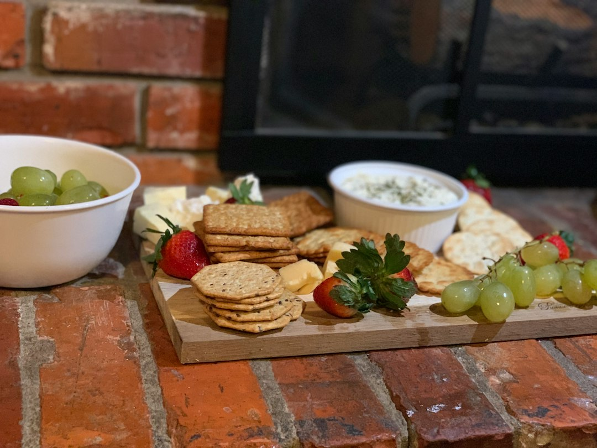

*Photo by [Aniston Grace](https://unsplash.com/@anistongrace) on [Unsplash](https://unsplash.com)*

Your cutting board is probably the most used tool in your kitchen, and it's also probably the most neglected. If you're still hacking away at a warped plastic board or a glass surface that dulls your knives, it's time for an upgrade. The good news: you don't need to spend a fortune. The best bamboo cutting board with juice groove under $25 gives you a durable, knife-friendly surface that actually looks good on your counter.

Bamboo boards with juice grooves solve two problems at once. They give you a tough prep surface that won't trash your knife edges, and they catch the mess before it hits your counter or floor. Let's get into why these boards are worth it, what to look for, and which specific picks are worth your money.

## Why Choose a Bamboo Cutting Board with Juice Groove?

Bamboo isn't just a trendy wood. It's grass, technically, which means it grows fast and regenerates without needing to be replanted. That makes it one of the most sustainable cutting board materials out there. But sustainability aside, bamboo also performs better than most alternatives in daily use.

**Benefits of bamboo as a cutting surface material**

Bamboo is naturally harder than most hardwoods like maple or walnut, which means it resists deep knife scarring better. Those scars matter because they trap bacteria and food particles over time. A denser surface also means less water absorption, so bamboo doesn't swell and crack the way softer woods can when they get wet repeatedly.

Bamboo also has a tighter grain structure. This gives it a smoother finish right out of the box and helps it stay looking newer for longer, even with regular use.

**How juice grooves improve food prep and cleanup**

A juice groove is that carved channel running around the perimeter of the board. It catches liquid runoff from juicy tomatoes, raw meat, citrus, or anything else that bleeds moisture while you cut. Without one, that liquid runs straight off the edge and onto your counter or floor.

Beyond the obvious mess reduction, juice grooves make it easier to transfer prepped ingredients without losing half the liquid along the way. If you're carving a roast or slicing watermelon, that groove is doing real work.

**Sustainability and eco-friendly advantages**

Bamboo reaches maturity in about three to five years, compared to decades for hardwood trees. It also requires fewer pesticides and less water to grow. If you care about where your kitchen tools come from, bamboo is one of the better choices available, especially compared to plastic boards that eventually end up in a landfill after a year or two of use.

**Durability and knife-friendliness compared to plastic or glass**

Glass boards look sleek, but they're brutal on knife edges. Every cut dulls your blade a little more. Plastic is gentler on knives but wears down fast, developing deep grooves that harbor bacteria no matter how well you scrub them.

Bamboo strikes the balance. It's forgiving enough on blades to keep your knives sharper longer, and it's dense enough to resist the kind of knife damage that ruins plastic boards within months.

## What to Look for When Buying Bamboo Cutting Boards Under $25

Not all budget bamboo boards are created equal. Here's what actually matters when you're shopping.

**Size considerations for different kitchen spaces**

Think about your counter space and your storage situation before buying. A board that looks reasonable in a photo can be surprisingly large in person. If you have a small kitchen, measure your counter and cabinet space first. If you cook for a family or do big meal preps, size up.

**Juice groove depth and effectiveness**

Not all grooves are built the same. Shallow grooves look nice but overflow fast when you're dealing with something like a juicy roast or a pile of sliced oranges. Look for boards with a groove at least a quarter-inch deep. Deeper grooves hold more liquid and actually do their job instead of just being decorative.

**Thickness and stability on countertops**

Thin boards are easy to store but can warp or slide around during use. Thicker boards, generally three-quarters of an inch or more, sit flatter and feel more stable when you're applying pressure with a knife. If you're doing heavy chopping, thickness matters more than you'd think.

**Handle options and portability features**

Handles make a board easier to lift, carry, and hang for storage. Some boards also include built-in feet or hang loops, which help with airflow during drying and make storage simpler. If you're tight on space, a board with a hang loop is a small detail that makes a real difference.

**Wood quality and manufacturing standards**

Cheap bamboo boards can be made with low-quality glues that aren't food safe or that break down with repeated washing. Look for boards that specify food-grade, non-toxic adhesives. This is especially important since you're putting raw food directly on the surface.

**Price-to-value ratio for budget shoppers**

Under $25 is a realistic budget for a quality bamboo board, but you want to avoid the absolute bottom of the barrel. The sweet spot is a board that's solid, properly finished, and sized right for your kitchen, not just the cheapest option in the search results.

## Small Bamboo Cutting Boards with Juice Groove (Under $25)

Small boards are underrated. They're perfect for quick tasks that don't require a full-size setup.

**Ideal dimensions and use cases**

Small boards typically run somewhere around 10 to 12 inches long. That's plenty of room for slicing a few vegetables, cutting cheese, or prepping garnish without dragging out a bigger board for a two-minute job.

**Best options for prep work and serving**

A <a href="https://www.amazon.com/s?k=Small%20rectangular%20bamboo%20cutting%20board%20with%20juice%20groove&tag=merrieri0a-20" data-inline>small rectangular bamboo cutting board with juice groove</a> works great as a dual-purpose piece. Use it for prep during the week, then set it out as a cheese or charcuterie board when people come over. The juice groove keeps cheese juices and fruit drips contained even when you're using it for serving instead of chopping.

**Space-saving benefits for small kitchens**

If you're working with limited cabinet space or a tiny apartment kitchen, a small board slides easily into a narrow gap between appliances or stands up in a dish rack without taking over the whole space. It's also light enough to wash by hand without wrestling with it in the sink.

**Portability for camping or travel**

Small boards are the obvious choice if you're car camping, prepping food at a cabin, or just want something to toss in a cooler bag for a picnic. They're light, they don't take up much room, and bamboo holds up fine outdoors as long as you dry it off after use.

## Medium Bamboo Cutting Boards with Juice Groove (Under $25)

If you only buy one cutting board, make it a medium one. This is the size that handles almost everything.

**Versatility for everyday cooking tasks**

Medium boards, usually somewhere between 14 and 16 inches, give you enough surface area for chopping a full meal's worth of vegetables, breaking down a chicken, or slicing bread, without becoming awkward to store or clean.

**Best balance of functionality and price**

A <a href="https://www.amazon.com/s?k=Medium%20bamboo%20cutting%20board%20with%20juice%20groove%20and%20handles&tag=merrieri0a-20" data-inline>medium bamboo cutting board with juice groove and handles</a> hits that sweet spot of being big enough for real cooking tasks but still easy to lift and carry with one hand thanks to the built-in handles. This is probably the best bamboo cutting board with juice groove under $25 for most people, since it covers the widest range of everyday kitchen tasks without forcing a tradeoff.

**Popular size range and availability**

Medium boards are the most commonly stocked size across retailers, which means more options, more styles, and generally better pricing since manufacturers produce them at scale.

**Suitable for families and meal prep**

If you're cooking for more than one or two people, a medium board gives you enough room to prep multiple ingredients at once instead of constantly clearing the board between steps. That matters if you're trying to get dinner on the table without juggling three cutting sessions in a row.

If you're doing a lot of batch cooking or weekly meal prep, pairing your board with a solid [vegetable chopper for quick prep](https://kitchen-finds.com/2026/10/21/best-vegetable-chopper-for-quick-prep-under-25-in-2026-top-rated-tools-reviewed/) can cut your prep time in half, especially for things like onions, peppers, and other veggies you're chopping in bulk.

## Large Bamboo Cutting Boards with Juice Groove (Under $25)

Large boards are where you start seeing serious butcher block energy, and it's genuinely surprising how many of these fit under the $25 mark.

**Premium options still under the budget cap**

A <a href="https://www.amazon.com/s?k=Large%20bamboo%20cutting%20board%20with%20deep%20juice%20groove&tag=merrieri0a-20" data-inline>large bamboo cutting board with deep juice groove</a> gives you the kind of surface area you'd expect from a pricier butcher block setup, minus the price tag. These boards usually run 18 inches or longer, with enough groove depth to handle a whole turkey carving session without overflow.

**Butcher block style considerations**

Larger boards are often thicker too, which gives them that heavier, more substantial feel on the counter. They sit flatter, resist sliding, and can double as a serving platform for big spreads since they look the part.

**Multi-functional uses in the kitchen**

A board this size isn't just for cutting. It works as a landing zone for hot pots, a surface for kneading dough, or a base for setting out a full charcuterie spread for guests. If you're into bread baking, check out our guide on [pasta maker tools for fresh noodles](https://kitchen-finds.com/2026/10/28/best-pasta-maker-tool-for-fresh-noodles-under-45-in-2026-top-picks-for-home-cooks/), since a large board gives you plenty of room to roll and cut dough too.

**Best value in this category**

Given the size and functionality you get, large bamboo boards under $25 are honestly one of the better values in the kitchen tool space right now. You're getting a multi-use surface that would easily cost double if it were made from a premium hardwood.

## Tips for Maintaining Your Bamboo Cutting Board

A good board can last years if you treat it right. Here's how to actually do that.

**Proper cleaning and drying techniques**

Wash your board with warm water and mild dish soap after every use. Avoid letting it soak, since standing water is what causes warping and cracking over time. Dry it immediately with a towel, then let it air dry standing upright so air can circulate on both sides.

**Oil treatments to extend lifespan**

Bamboo needs oil to stay hydrated and crack-resistant, just like your skin in winter. Use food-grade mineral oil, not olive oil or vegetable oil, since those can go rancid and leave your board smelling off. Oil it once a month for regular use, or more often if you notice the surface looking dry or pale.

**Storage recommendations**

Store your board upright in a rack rather than laying it flat, especially if it's still damp. Flat storage traps moisture against the surface and increases the risk of warping. A board with a built-in hang loop makes this easy, since you can just hook it on a wall mount or inside a cabinet door.

**Avoiding common damage and warping**

Never put a bamboo board in the dishwasher. The heat and prolonged water exposure will cause it to crack or warp, sometimes within a single cycle. Also avoid leaving it near a stove or in direct sunlight for long periods, since both can dry out the wood unevenly.

**When to replace your cutting board**

If you start seeing deep grooves that don't sand out, persistent dark staining, or cracks that run through the board, it's time to replace it. Those deep grooves are a bacteria risk no matter how well you clean the surface.

## FAQ

**What size bamboo cutting board with juice groove is best for a small apartment kitchen?**

A small or medium board is your best bet. Small boards, around 10 to 12 inches, are ideal if counter and storage space are tight. If you want a bit more room without taking over your kitchen, a medium board around 14 inches still fits comfortably in most apartment setups while giving you more prep room.

**Are bamboo cutting boards with juice grooves safe for raw meat preparation?**

Yes, as long as you clean them properly after each use. Bamboo's dense grain resists bacteria absorption better than softer woods, and the juice groove helps contain raw meat runoff so it doesn't spread across your counter. Just make sure to wash with hot soapy water immediately after use and consider keeping a separate board dedicated to raw meat only.

**How often should I oil my bamboo cutting board with a juice groove?**

Once a month is a good baseline for regular home use. If you're using the board daily or washing it frequently, you might need to oil it every two to three weeks. The board will tell you when it needs it: if the surface looks dry, dull, or pale, it's time.

**Can you put a bamboo cutting board with juice groove in the dishwasher?**

No. Dishwashers combine prolonged water exposure with high heat, which is the exact combination that causes bamboo to crack and warp. Always hand wash and dry immediately instead.

**Do juice grooves on bamboo boards actually prevent bacteria from spreading?**

Juice grooves don't prevent bacteria on their own, but they do reduce mess and cross-contamination risk by containing liquid runoff instead of letting it spread across your counter or drip onto the floor. Combined with proper washing and drying, a groove is a meaningful upgrade over a flat board with no containment at all.

Whether you go small, medium, or large, the right bamboo board comes down to matching the size to how you actually cook. If you're after something versatile that works for travel, outdoor cooking, or just extra storage ease, a <a href="https://www.amazon.com/s?k=Bamboo%20cutting%20board%20with%20juice%20groove%20and%20hang%20loop&tag=merrieri0a-20" data-inline>bamboo cutting board with juice groove and hang loop</a> checks a lot of boxes. And if stability on the counter is your main concern, look for a <a href="https://www.amazon.com/s?k=Bamboo%20cutting%20board%20with%20juice%20groove%20and%20feet/rubber%20base&tag=merrieri0a-20" data-inline>bamboo cutting board with juice groove and feet</a> to keep things from sliding around while you work. Once you've got your board sorted, pairing it with the right prep tools, like a dedicated [herb stripper for fresh herbs](https://kitchen-finds.com/2026/10/30/best-herb-stripper-for-fresh-herbs-under-15-in-2026-top-picks-for-every-kitchen/), rounds out a setup that makes daily cooking genuinely easier.

## Related Articles

- [Best Silicone Squeeze Bottles for Condiments Under $20 in 2026: Top Picks for Your Kitchen](https://kitchen-finds.com/2026/11/06/best-silicone-squeeze-bottles-for-condiments-under-20-in-2026-top-picks-for-your-kitchen/)
- [Best Avocado Slicer and Pit Remover Under $12 in 2026: Top Budget-Friendly Tools Reviewed](https://kitchen-finds.com/2026/11/04/best-avocado-slicer-and-pit-remover-under-12-in-2026-top-budget-friendly-tools-reviewed/)
- [Best Herb Stripper for Fresh Herbs Under $15 in 2026: Top Picks for Every Kitchen](https://kitchen-finds.com/2026/10/30/best-herb-stripper-for-fresh-herbs-under-15-in-2026-top-picks-for-every-kitchen/)
