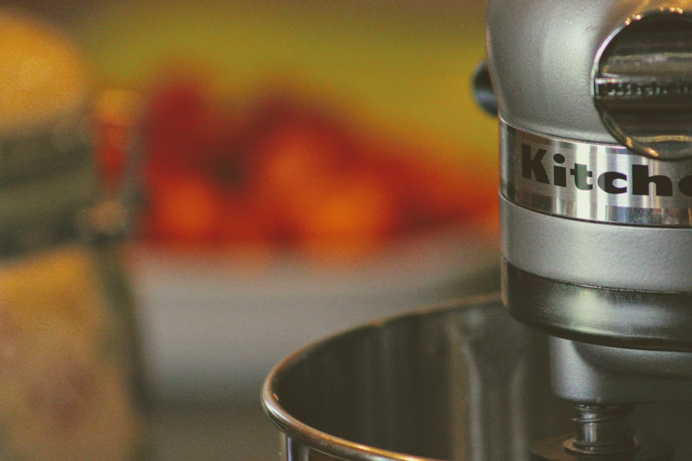

*Photo by [Joshua Hoehne](https://unsplash.com/@joshua_hoehne) on [Unsplash](https://unsplash.com)*

Every kitchen needs mixing bowls that actually work. Not the flimsy plastic ones that warp in the dishwasher. Not the glass ones that chip the first time you drop them. We're talking stainless steel: the stuff that outlasts your other cookware and still looks good doing it.

Finding the best stainless steel mixing bowls under $40 isn't hard once you know what to look for. The tricky part is sorting through hundreds of listings that all look identical in photos but perform completely differently once they're in your hands. This guide breaks down exactly what matters, what to buy, and why your mixing bowl choice affects everything from bread dough to whipped cream.

## Why Stainless Steel Mixing Bowls Are Worth the Investment

Plastic bowls stain. They absorb garlic smell and turmeric color and never quite let go. Glass bowls are heavy, breakable, and honestly kind of a pain to store. Stainless steel skips all of those problems.

A good steel bowl will outlast you. It won't crack if it hits the floor. It won't scratch if you leave a metal spoon in it. It won't hold onto odors from last week's curry. That's the durability argument, and it's a strong one, but it's not the only reason steel wins.

Stainless steel is incredibly versatile. You can use the same bowl to whip egg whites, marinate chicken, proof bread dough, or toss a salad. Some bowls can even go over a pot of simmering water as a makeshift double boiler for melting chocolate. Try that with plastic.

Heat resistance matters more than people think. Steel doesn't warp under hot liquids, doesn't melt near a stovetop, and won't react with acidic ingredients like tomatoes, citrus, or vinegar-based marinades. Glass and ceramic can be non-reactive too, but they bring weight and fragility that steel just doesn't have.

And yes, steel looks good. A stack of nesting steel bowls on an open shelf reads as "someone who cooks" in a way that mismatched plastic containers never will. It's a small thing, but kitchens built around clean, functional tools tend to feel calmer to work in.

## What to Look for in a Quality Stainless Steel Mixing Bowl

Not all stainless steel is created equal, and price alone won't tell you much. Here's what actually separates a great bowl from a cheap one.

**Gauge and thickness.** Thinner steel is lighter but dents easier and can feel flimsy when you're whisking hard. Look for bowls that feel solid in your hand, with no flex when you press the sides. Heavier gauge steel also tends to resist denting if dropped, which matters if you're prone to kitchen chaos like the rest of us.

**Capacity and size range.** A bowl that's too small means batter on your counter. Too big and you're wasting space and ingredients get lost on the bottom. Most home cooks need at least three sizes: something small for whisking a dressing, something medium for everyday mixing, and something large for bread dough or big batches.

**Lip design.** A good pouring lip makes a huge difference when you're transferring batter into a pan without dripping everywhere. Look for a slight spout or a pinched edge rather than a perfectly round rim, which tends to dribble down the side.

**Non-slip bases.** This is the feature people don't think about until they're chasing a bowl across the counter while trying to whisk with one hand. A silicone ring or rubberized base keeps the bowl planted, which matters a lot if you're using an electric hand mixer instead of a stand mixer.

**Nesting capability.** If you're buying a set, the bowls should nest tightly for storage. Loose nesting wastes cabinet space and defeats half the point of buying a set in the first place.

## Best Budget-Friendly Stainless Steel Mixing Bowl Sets Under $40

If you're starting from scratch or replacing your entire collection, a set is usually the smartest move. You get multiple sizes, matching aesthetics, and better value per bowl than buying individually.

The <a href="https://www.amazon.com/s?k=stainless%20steel%20mixing%20bowl%203-piece%20set&tag=merrieri0a-20" data-inline>stainless steel mixing bowl 3-piece set</a> is a solid entry point for anyone who doesn't need a dozen bowls cluttering their cabinets. Three sizes cover most everyday tasks: small for dressings and sauces, medium for general prep, large for salads or bigger mixing jobs. These sets usually run well under $40 and still manage to pack in a non-slip base and a decent mirror finish.

For people who do more serious baking or cook for a crowd regularly, the <a href="https://www.amazon.com/s?k=stainless%20steel%20mixing%20bowl%205-piece%20nesting%20set&tag=merrieri0a-20" data-inline>stainless steel mixing bowl 5-piece nesting set</a> is the better buy. Five sizes means you're covered for everything from a single egg wash to a massive batch of cookie dough. The nesting design also saves serious cabinet space, which matters if your kitchen storage is already stretched thin.

What consumers consistently report across these sets: the bowls hold up well to daily use, the finishes don't dull quickly, and the capacity range actually gets used rather than sitting in the back of a cabinet. The complaints that do show up are usually about thinner gauge steel on the smallest bowls, which can feel less sturdy than the larger ones. That's a reasonable tradeoff at this price point, and it rarely affects actual performance for light tasks like whisking eggs or tossing prep ingredients.

## Single Stainless Steel Mixing Bowls Under $40

Sometimes a full set isn't what you need. Maybe you already have bowls but want to upgrade one specific size, or maybe you want a workhorse bowl for one particular job. Buying individually gives you more control over quality per bowl.

For big batches, bread dough, or anything that needs serious room to work, the <a href="https://www.amazon.com/s?k=large%20capacity%20stainless%20steel%20mixing%20bowl%20with%20non-slip%20base&tag=merrieri0a-20" data-inline>large capacity stainless steel mixing bowl with non-slip base</a> is worth the spot in your cabinet. The non-slip base is especially useful here because bigger bowls take more force to mix in, and nothing's worse than a heavy bowl sliding across the counter mid-knead.

For everyday use, a bowl with built-in measurement markings saves a step you didn't realize you were taking every time you cook. The <a href="https://www.amazon.com/s?k=stainless%20steel%20mixing%20bowl%20with%20measurement%20markings&tag=merrieri0a-20" data-inline>stainless steel mixing bowl with measurement markings</a> lets you eyeball liquid or dry ingredient volumes without pulling out a separate measuring cup, which is a small convenience that adds up over hundreds of recipes.

For prep work, smaller bowls matter more than people realize. Chopped garlic, diced onion, measured spices, all of it needs somewhere to sit before it goes into the pan. If you're building out your prep station, pair a small steel bowl with something like [this bamboo cutting board](https://kitchen-finds.com/2026/11/11/best-bamboo-cutting-boards-with-juice-groove-under-25-in-2026-top-picks-for-every-kitchen/) for a setup that handles everything from vegetable prep to mise en place without clutter.

If you want something that feels like a step above standard retail bowls, the <a href="https://www.amazon.com/s?k=premium%20satin%20finish%20stainless%20steel%20mixing%20bowl&tag=merrieri0a-20" data-inline>premium satin finish stainless steel mixing bowl</a> brings a weighted base and a finish that resists fingerprints and water spots better than cheaper mirror-polished bowls. It's a good option if you want one standout bowl that looks nice enough to serve from directly, not just mix in.

## Mixing Bowl Sets vs. Individual Bowls: Which is Better for Your Kitchen

This comes down to how you cook and how much space you have.

Sets win on cost. You're almost always paying less per bowl when you buy a 3 or 5-piece set versus buying each size separately. If you're setting up a kitchen from zero, a set gets you functional across almost every task immediately.

Individual bowls win on flexibility. If you already own two sizes and just need a third, buying a whole new set means duplicate bowls taking up space you don't have. Buying single pieces lets you fill exact gaps without waste.

Storage is a real factor too. A 5-piece nesting set takes up roughly the same footprint as a single large bowl, since they're designed to stack inside each other. Individual bowls bought separately might not nest as cleanly if they're from different brands or product lines, which can mean more shelf space used for less payoff.

Aesthetics matter more than people admit. A matched set looks intentional on open shelving or a countertop. A mismatched pile of bowls from different brands just looks like clutter, even if every bowl individually works fine.

Our take: if you're starting out, get a set. If you're filling a specific gap or upgrading one size, buy individually and don't feel like you need to replace bowls that are already working.

## Top Features That Justify the Price

Some features are nice to have. Others are the actual reason a $35 bowl outperforms a $12 one.

**Reinforced rims.** Cheap bowls often have a raw or single-folded edge that can bend or even develop sharp spots over time. Better bowls roll and reinforce the rim, which prevents warping and keeps the edge safe to handle for years.

**Mirror vs. satin finish.** Mirror finish looks striking out of the box but shows every fingerprint, water spot, and scratch. Satin finish hides minor wear better and tends to look good even after months of daily use. Neither affects performance, it's purely a look-and-maintenance choice.

**Interior measurement markings.** This feature seems minor until you're making pancake batter at 7am and don't want to dig out a measuring cup. Bowls like the <a href="https://www.amazon.com/s?k=stainless%20steel%20mixing%20bowl%20with%20measurement%20markings&tag=merrieri0a-20" data-inline>stainless steel mixing bowl with measurement markings</a> fold this convenience directly into the bowl so you're not juggling extra tools.

**Induction compatibility.** Most stainless steel mixing bowls aren't designed to go directly on a cooktop, but some can double as a makeshift bain-marie or double boiler if they're magnetic-grade steel. Check the product description if this matters for your cooking style, since not every "stainless steel" listing uses the same alloy.

**Dishwasher safe.** Nearly all steel bowls at this price point are dishwasher safe, but the finish quality affects how well they hold up over hundreds of cycles. Satin finishes tend to show less wear from repeated dishwasher use than high-polish mirror finishes.

If pouring is a big part of your workflow, especially for pancake batter, cake mix, or sauces, a bowl designed specifically for pouring makes a real difference. The <a href="https://www.amazon.com/s?k=stainless%20steel%20mixing%20bowl%20with%20pour%20spout%20and%20handle&tag=merrieri0a-20" data-inline>stainless steel mixing bowl with pour spout and handle</a> solves the dribble-down-the-side problem that flat-rim bowls almost always have. It's a small design change that saves a surprising amount of cleanup.

For anyone focused on baking specifically, weight matters differently than it does for general cooking. The <a href="https://www.amazon.com/s?k=lightweight%20stainless%20steel%20mixing%20bowl%20set%20for%20baking&tag=merrieri0a-20" data-inline>lightweight stainless steel mixing bowl set for baking</a> is built to be easy to lift and tilt one-handed, which matters when you're folding batter or scraping down the sides repeatedly during a baking session. Pair that with reliable timing tools like [this kitchen timer](https://kitchen-finds.com/2026/10/16/best-kitchen-timer-with-actual-accuracy-under-20-in-2026-top-picks-for-reliable-cooking/) and you've got a setup that actually respects how baking works in real time, not just in theory.

## FAQ: Common Questions About Stainless Steel Mixing Bowls Under $40

**How thick should stainless steel mixing bowls be?**
Most quality mixing bowls use 18/8 or 18/10 stainless steel, with gauge thickness typically between 0.6mm and 1mm. Thicker gauge feels sturdier and resists denting, but it also adds weight. For most home use, anything in that range performs well. Avoid bowls that feel like they flex significantly when you press the sides with moderate pressure.

**Can you use stainless steel bowls on the stovetop?**
Generally, no. Most stainless steel mixing bowls aren't designed for direct stovetop heat. However, many work fine as a double boiler setup placed over a pot of simmering water, which is the standard method for melting chocolate or making custards without scorching.

**Are stainless steel bowls better than glass for mixing?**
For most tasks, yes. Steel is lighter, unbreakable, and doesn't retain heat or cold the way glass does. Glass has one advantage: it's microwave safe, which steel is not. If you need a bowl that goes straight from mixing to microwave reheating, keep one glass bowl around for that specific purpose and use steel for everything else.

**What size mixing bowl do I need?**
For general cooking, a 3 to 5 quart bowl handles most everyday tasks like tossing salads or mixing batter. For bread baking or large batch cooking, go up to 8 quarts or larger. For small jobs like whisking dressing or beating a couple of eggs, a 1 to 2 quart bowl is ideal. This is why sets with multiple sizes tend to be the most practical purchase.

**Do stainless steel bowls work with electric mixers?**
Yes, and they work especially well with hand mixers because the non-slip base keeps the bowl steady while you're using both hands. Steel's weight also helps anchor the bowl better than lightweight plastic during high-speed mixing. If you're using a stand mixer, check that the bowl diameter fits comfortably under your mixer's arm before buying a replacement bowl separately.

Choosing the best stainless steel mixing bowls under $40 really comes down to matching bowl features to how you actually cook. If you bake often, prioritize lightweight options with measurement markings. If you cook in big batches, go for a large bowl with a non-slip base. And if you're just building out your kitchen from scratch, a nesting set gives you the most coverage for the least money. Whatever you pick, steel bowls are one of those purchases that quietly pay for themselves every single time you use them.

## Related Articles

- [Best Bamboo Cutting Boards with Juice Groove Under $25 in 2026: Top Picks for Every Kitchen](https://kitchen-finds.com/2026/11/11/best-bamboo-cutting-boards-with-juice-groove-under-25-in-2026-top-picks-for-every-kitchen/)
- [Best Silicone Squeeze Bottles for Condiments Under $20 in 2026: Top Picks for Your Kitchen](https://kitchen-finds.com/2026/11/06/best-silicone-squeeze-bottles-for-condiments-under-20-in-2026-top-picks-for-your-kitchen/)
- [Best Avocado Slicer and Pit Remover Under $12 in 2026: Top Budget-Friendly Tools Reviewed](https://kitchen-finds.com/2026/11/04/best-avocado-slicer-and-pit-remover-under-12-in-2026-top-budget-friendly-tools-reviewed/)
