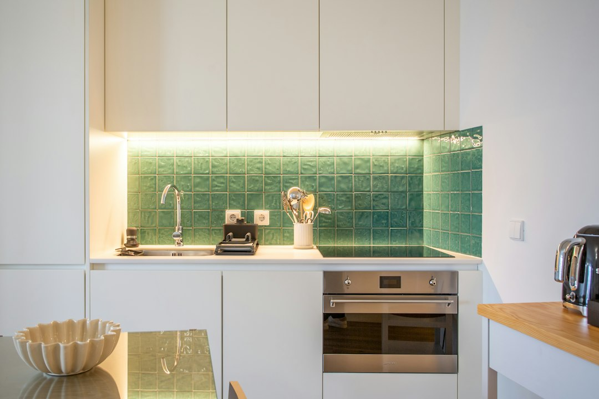

*Photo by [Aquilion Property](https://unsplash.com/@aquilionproperty) on [Unsplash](https://unsplash.com)*

If you've ever tried to fit a full-size toaster oven on a studio apartment counter next to your four-burner stove and single dish rack, you know the struggle. Most "compact" ovens on the market are still built for families, not for someone toasting a bagel six inches from their kitchen sink. And the good ones that actually fit? They're often priced like you're buying an appliance for a mansion kitchen, not a 400-square-foot studio.

The truth is, you don't need to spend $150 to get a toaster oven that toasts evenly, fits in a cabinet, and doesn't eat your entire counter. There are solid, no-nonsense options under $50 that do exactly what a studio kitchen needs: toast, reheat, bake a small batch of cookies, and get out of the way.

I looked at specs, capacity, and real owner feedback to find four toaster ovens that punch above their price tag. Here's what actually works for small-space living.

## Quick Picks

- **Best overall:** Elite Gourmet ETO236 Compact 2-Slice Toaster Oven: Small footprint with full toaster-oven function, not just a glorified toaster
- **Best for tiny counters:** Dash Mini Toaster Oven: The smallest option here, ideal if counter space is measured in inches
- **Best for slightly bigger appetites:** Elite Gourmet ETO490 9L/4-Slice Oven: More capacity without jumping up in price much
- **Best value 2-in-1:** Hamilton Beach 2-in-1 Countertop Toaster Oven and Toaster: Does toaster duty and oven duty in one unit

## Comparison Table

| Product | Best For | Capacity | Key Perk |
|---|---|---|---|
| Elite Gourmet ETO236 | Studio apartments, solo cooks | 2-slice | Compact oven with real bake/broil function |
| Dash Mini Toaster Oven | Extremely tight counters | 1-slice/mini pizza | Smallest footprint on this list |
| Elite Gourmet ETO490 | Small households wanting more room | 9L/4-slice | 30-minute timer, more interior space |
| Hamilton Beach 2-in-1 | Dorms and studios wanting dual function | 4-slice | Toaster and oven combined in one unit |

## How We Picked These

Three things mattered most: price (all under $50), physical footprint (studio-friendly), and whether the oven does more than just toast bread. I also weighed owner reviews for reliability, since a $40 appliance that dies in two months isn't actually a deal. Capacity matters too, so I included a mix of ultra-compact and slightly roomier options depending on how much counter real estate you're working with.

## The Best Toaster Ovens for a Studio Apartment Under $50

### Elite Gourmet ETO236 Compact 2-Slice Toaster Oven

This is the one I'd point most studio dwellers toward first. It's small enough to tuck on a narrow counter or even a cart, but it still functions like a real toaster oven, not just a toaster with a door. You can bake a few cookies, melt cheese on toast, or warm up leftovers without needing a full-size appliance.

**Best for:** solo renters who want actual baking function in a tiny package

**Pros:**
- Fits two slices of bread or a small personal pizza
- Bake and broil settings, not just toast
- Compact enough for a cabinet or narrow counter

**Cons:**
- Interior rack is small, so forget a full chicken breast
- Exterior gets warm to the touch during long bakes, keep it away from curtains or paper towels

[→ Check price on Amazon](https://www.amazon.com/dp/B09XWG4LW5?tag=merrieri0a-20)

### Dash Mini Toaster Oven

If your counter space is genuinely tiny, this is the one to check first. The Dash Mini is built for real life in small spaces: toast a single slice, warm a mini pizza, or heat up a small portion without dedicating prime counter real estate to a bulky appliance. It's less about versatility and more about simply fitting.

**Best for:** people with barely any counter space to spare

**Pros:**
- Smallest footprint of any option on this list
- Simple dial controls, nothing to learn or program
- Lightweight enough to store in a cabinet between uses

**Cons:**
- Capacity is genuinely tiny, one slice or one small item at a time
- No bake or broil setting, so it's toasting and reheating only

[→ Check price on Amazon](https://www.amazon.com/dp/B07N9K87XB?tag=merrieri0a-20)

### Elite Gourmet ETO490 9L/4-Slice Oven

If you cook for yourself most nights but occasionally want to make more than a single slice of toast, this one gives you breathing room. The 9-liter interior fits four slices of bread or a small personal-size dish, and the 30-minute timer takes the guesswork out of reheating or baking. It's still compact, just a notch up from the ultra-mini options.

**Best for:** people who want more interior space without buying a full-size oven

**Pros:**
- 4-slice capacity handles more than solo toasting
- 30-minute timer with auto shutoff, so you can walk away without worrying
- Still compact enough for a studio counter

**Cons:**
- Larger footprint than the Dash or ETO236, measure your counter first
- Exterior housing isn't insulated, so keep it a few inches from the wall or other appliances

[→ Check price on Amazon](https://www.amazon.com/dp/B0DDWPX76J?tag=merrieri0a-20)

### Hamilton Beach 2-in-1 Countertop Toaster Oven and Toaster

This one solves a specific studio apartment problem: not having room for both a toaster and a toaster oven. The Hamilton Beach combines both into a single compact unit, with a slide-out tray for toasting duty and an oven compartment for baking or reheating. It's a clever space-saver if you genuinely only have room for one appliance.

**Best for:** studio kitchens that can't fit a separate toaster and oven

**Pros:**
- Combines toaster and oven function in one unit, saves counter space
- Slide-out crumb tray on the toaster side makes cleanup easy
- Comes in under $50 even with two appliances built into one

**Cons:**
- Toaster slots are narrow, thick artisan bread may not fit
- Oven side has a manual dial with no digital display, so you're estimating temperature by feel at first

[→ Check price on Amazon](https://www.amazon.com/dp/B0758B74DS?tag=merrieri0a-20)

## What to Skip

- Avoid toaster ovens with glass doors that run hot to the touch if you're placing them near curtains, paper towels, or anything flammable in a tight kitchen.
- Skip models with digital touchscreens in this price range. They're often the first thing to fail, and a simple dial is more reliable long-term.
- Don't buy based on wattage alone. A higher-wattage mini oven in a small space can trip older apartment circuits, especially if it's sharing an outlet with a microwave or kettle.

## Frequently Asked Questions

**What size toaster oven is best for a small studio apartment?**
Look for something under 15 inches wide with a 2 to 4-slice capacity. Anything larger tends to dominate a small counter and makes it hard to use adjacent appliances.

**Can a toaster oven under $50 actually bake, not just toast?**
Yes, several budget models include bake and broil settings, not just toast function. The Elite Gourmet ETO236 and ETO490 both handle basic baking tasks like cookies or small casseroles.

**Is it safe to run a toaster oven on the same outlet as a microwave in a studio apartment?**
It depends on your circuit's amperage. Most studio apartments can handle one high-wattage appliance at a time per outlet, so avoid running a toaster oven and microwave simultaneously on the same circuit to prevent tripped breakers.

## The Bottom Line

You don't need a big budget or a big kitchen to get a toaster oven that actually works. The Elite Gourmet ETO236 is the best all-around pick for most studio apartments, while the Dash Mini suits the tightest spaces and the Hamilton Beach 2-in-1 saves you from buying two appliances. Pick based on your counter space and how much you actually cook, not just the lowest price tag.

---

## Related Articles

- [Best Stainless Steel Mixing Bowls Under $40 in 2026: Top Picks for Every Kitchen](https://kitchen-finds.com/2026/11/13/best-stainless-steel-mixing-bowls-under-40-in-2026-top-picks-for-every-kitchen/)
- [Best Bamboo Cutting Boards with Juice Groove Under $25 in 2026: Top Picks for Every Kitchen](https://kitchen-finds.com/2026/11/11/best-bamboo-cutting-boards-with-juice-groove-under-25-in-2026-top-picks-for-every-kitchen/)
- [Best Silicone Squeeze Bottles for Condiments Under $20 in 2026: Top Picks for Your Kitchen](https://kitchen-finds.com/2026/11/06/best-silicone-squeeze-bottles-for-condiments-under-20-in-2026-top-picks-for-your-kitchen/)