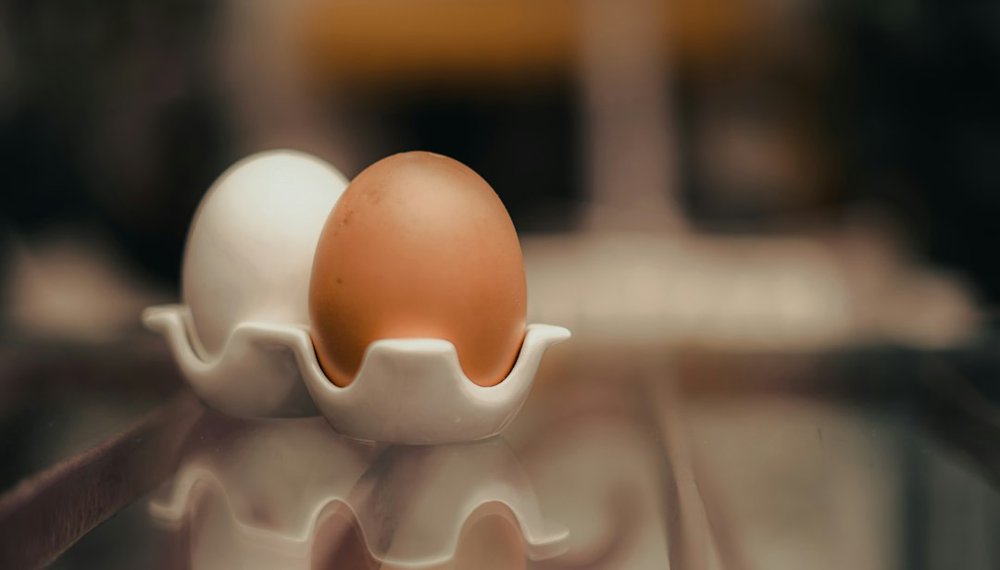

*Photo by [Ankit Gupta](https://unsplash.com/@ankit_toxic) on [Unsplash](https://unsplash.com)*

You're running late. Again. The coffee's brewing, your shoes are half-on, and breakfast is looking like a granola bar eaten in the car. Sound familiar?

A microwave egg cooker fixes this problem for less than the cost of two fancy coffees. These little gadgets turn raw eggs into breakfast in under five minutes, no stovetop, no scrubbing a crusty pan, no standing around waiting for water to boil. If you've been putting off buying one because you think they're gimmicky, this is your sign to stop sleeping on them.

## Why a Microwave Egg Cooker Should Be in Your Kitchen

### Time-saving benefits for busy mornings

Boiling eggs on the stove takes forever when you factor in heating the water, waiting for a rolling boil, cooking time, then cooling. That's easily 15-20 minutes you don't have on a Tuesday morning. A microwave egg cooker cuts that down to 3-6 minutes total, start to finish. You crack the egg, add water if needed, hit start, and you're plating breakfast while your coffee's still hot.

### Cost-effectiveness compared to other breakfast appliances

Egg bite makers, fancy omelet machines, breakfast sandwich makers... they all do one thing and cost $30-$60. A solid microwave egg cooker does the same job for a fraction of the price, often under $15. You're not buying a countertop appliance that eats up space and collects dust after week two. You're buying a small tool that earns its keep every single morning.

### Versatility for different egg cooking styles

This is the part people don't expect. The best microwave egg cooker for quick breakfast under $15 isn't limited to one style. You can poach, scramble, hard-boil, or make a full omelet depending on which design you grab. Some cookers even let you switch styles just by changing the water level or cook time. One tool, multiple breakfasts, zero extra equipment.

### Why microwave egg cookers outperform stovetop methods

Stovetop cooking means babysitting a pot, risking a boil-over, and dealing with shells that stick no matter what vinegar trick you tried. Microwave cookers are sealed, contained, and mess-free. No shells to peel awkwardly, no pot to scrub, no risk of cracked eggs leaking into boiling water. It's a cleaner process from start to finish, and cleanup usually means rinsing one small piece of plastic or silicone.

## How to Choose the Right Microwave Egg Cooker Under $15

### Key features to look for

Capacity matters more than people think. If you're cooking for one, a single-egg pod works fine. Feeding a family of four? You want a cooker with multiple compartments so you're not running three cycles before everyone's fed. Check the material too. BPA-free plastic and food-grade silicone are the standards you want, nothing less. A non-stick coating on omelet makers saves you from fighting with stuck-on egg residue every single day.

### Size and portability considerations

Some of these cookers are small enough to toss in a bag for the office microwave. If you're prepping breakfast at your desk, look for compact designs with secure lids so you're not spilling egg water in your tote. For home use, slightly bigger multi-compartment designs make more sense since you're not hauling them anywhere.

### Durability and heat resistance ratings

Cheap plastic that warps after three uses isn't saving you money, it's costing you a repeat purchase. Look for products rated for repeated microwave use and labeled heat-resistant up to at least 400°F. Silicone options tend to hold up better over time since they flex instead of crack.

### Brand reputation and customer reviews in 2026

Reviews matter here more than brand names. A lot of these egg cookers come from smaller kitchen gadget brands, so check recent reviews (not just the top ones from three years ago) to see if quality has held steady. Look for comments about leaking, cracking, or egg sticking to the surface. That's your early warning system.

## Top Microwave Egg Cooker Options Under $15

### Plastic microwave egg cookers with built-in timers

These are great if you want a no-guesswork option. A <a href="https://www.amazon.com/s?k=plastic%20microwave%20egg%20cooker%20with%20timer&tag=merrieri0a-20" data-inline>plastic microwave egg cooker with timer</a> takes the guessing out of cook time, some even have a built-in timer dial so you're not standing at the microwave counting down. Good for people who want consistent results every time without thinking about it.

### Silicone microwave egg cooker pods

If you want something flexible, literally, a <a href="https://www.amazon.com/s?k=silicone%20microwave%20egg%20pod&tag=merrieri0a-20" data-inline>silicone microwave egg pod</a> is a solid pick. Silicone handles heat well, doesn't warp, and pops eggs out easily once cooked. These are great for poached-style eggs with a soft, runny center, perfect for topping toast or a breakfast bowl.

### Microwave egg boiler with multiple compartments

Cooking for the whole house? A <a href="https://www.amazon.com/s?k=microwave%20egg%20boiler%20with%20multiple%20compartments&tag=merrieri0a-20" data-inline>microwave egg boiler with multiple compartments</a> lets you cook 2-4 eggs at once, each in its own section so they don't fuse together. This is the one to grab if you meal prep hard-boiled eggs for the week in one go.

### Microwave omelet maker with non-stick surface

Want something more substantial than a boiled egg? A <a href="https://www.amazon.com/s?k=microwave%20omelet%20maker%20with%20non-stick%20coating&tag=merrieri0a-20" data-inline>microwave omelet maker with non-stick coating</a> lets you whisk in veggies, cheese, or leftover ham and microwave the whole thing into a fluffy omelet in about 90 seconds. The non-stick layer means it slides right out onto your plate.

### Microwave scrambled egg cooker for single servings

Single-serving scrambled eggs used to mean dirtying a pan for just yourself. A microwave scrambled egg cooker solves that. Crack, whisk, microwave, done. These are compact and usually dishwasher safe, which matters when you're not trying to add extra steps to your morning.

### Microwave egg poacher with removable trays

Poached eggs intimidate a lot of home cooks because stovetop poaching is finicky. A <a href="https://www.amazon.com/s?k=microwave%20egg%20poacher%20with%20removable%20trays&tag=merrieri0a-20" data-inline>microwave egg poacher with removable trays</a> removes the guesswork. The removable tray design also makes cleanup faster since you're not scrubbing inside a tight mold.

### Microwave hard-boiled egg cooker with steaming tray

If hard-boiled eggs are your go-to protein snack, a <a href="https://www.amazon.com/s?k=microwave%20hard-boiled%20egg%20cooker%20with%20steaming%20tray&tag=merrieri0a-20" data-inline>microwave hard-boiled egg cooker with steaming tray</a> steams the eggs instead of fully submerging them, which some people find gives a more even, less rubbery texture. Great for batch cooking snacks for the week.

## Pro Tips for Perfect Microwave Egg Cooking

### Optimal microwave wattage settings

Most microwave egg cookers are designed around 1000-watt microwaves. If yours runs lower wattage, add 15-20 seconds to whatever the instructions say. Higher wattage (1200W+) means you should check a few seconds early to avoid overcooking. It takes one or two tries to dial in your specific microwave, then you'll have it memorized.

### Water-to-egg ratios for best results

Water is what creates steam, and steam is what cooks the egg evenly without turning it into a rubbery mess. For poaching, about 2-3 tablespoons of water per egg is standard. For hard-boiling in a steaming-style cooker, follow the fill line, usually around a quarter cup total. Too little water and you get a scorched, unevenly cooked egg. Too much and you risk overflow.

### Timing guidelines for soft, medium, and hard-cooked eggs

For a soft-cooked egg, 45-60 seconds is usually enough in most pod-style cookers. Medium doneness lands around 60-75 seconds. Hard-cooked eggs typically need 4-6 minutes in a boiler-style cooker with steam. Always start on the lower end and add 10-second increments since microwaves vary so much between models.

### Cleaning and maintenance to extend product lifespan

Rinse immediately after use so egg residue doesn't bake onto the surface. Most of these cookers are top-rack dishwasher safe, but hand washing silicone pods extends their lifespan since repeated dishwasher heat cycles can degrade the material faster. Avoid abrasive scrubbers on non-stick omelet makers, a soft sponge keeps the coating intact longer.

## Comparison: Microwave Egg Cookers vs. Traditional Methods

### Speed comparison with stovetop boiling

Stovetop boiling: 15-20 minutes including water heating and cooling time. Microwave egg cooker: 3-6 minutes total. That's not a small difference, that's the gap between skipping breakfast and actually eating it.

### Energy efficiency benefits

Microwaves use significantly less energy than heating a full pot of water on a stovetop burner, especially electric ranges which take time to heat up and cool down. Running a microwave for 90 seconds costs pennies compared to running a burner for 15+ minutes.

### Consistency and reliability factors

Stovetop boiling is unpredictable. Altitude, pot size, and burner strength all throw off your timing. A microwave egg cooker, once you've dialed in your wattage and timing, gives nearly identical results every time. No more guessing if today's egg will be chalky or runny.

### Cost analysis over 12 months of use

A $12 microwave egg cooker, used daily, costs you about three cents a day in electricity. Compare that to the time cost of stovetop cooking (which adds up if you value your mornings) and the occasional ruined pot from boil-overs. Over a year, you're looking at a gadget that pays for itself in saved time within the first week.

## Best Budget Hacks for Breakfast Prep

### Combining microwave egg cookers with other under-$50 gadgets

Pair your egg cooker with a good [vegetable chopper](https://kitchen-finds.com/2026/10/21/best-vegetable-chopper-for-quick-prep-under-25-in-2026-top-rated-tools-reviewed/) to dice peppers, onions, and spinach for omelets in seconds. Prep your mix-ins the night before, store them in the fridge, and your morning omelet comes together in under two minutes total.

### Meal prep strategies using microwave egg cookers

Batch-cook a week's worth of hard-boiled eggs using a multi-compartment boiler on Sunday. Store them in the fridge and you've got grab-and-go protein for five days straight. If you're already prepping produce for the week, keep your prepped veggies in [stainless steel mixing bowls](https://kitchen-finds.com/2026/11/13/best-stainless-steel-mixing-bowls-under-40-in-2026-top-picks-for-every-kitchen/) so everything's organized and ready to grab.

### Storage solutions for pre-cooked eggs

Peeled hard-boiled eggs last about a week in the fridge if stored in a sealed container with a damp paper towel to prevent drying out. Unpeeled eggs last slightly longer. Label the date if you're someone who forgets what's been sitting in there for a week and a half.

### Time management for weekday mornings

The real hack here is prepping your station the night before. Set your egg cooker on the counter, have your eggs within reach, and if you're making omelets, chop your veggies ahead and store them on a [bamboo cutting board with a juice groove](https://kitchen-finds.com/2026/11/11/best-bamboo-cutting-boards-with-juice-groove-under-25-in-2026-top-picks-for-every-kitchen/) so there's no mess to deal with at 6am. Small prep steps the night before save you minutes you don't have in the morning.

## FAQ: Common Questions About Microwave Egg Cookers

**How long does it take to cook an egg in a microwave egg cooker?**

Most eggs cook in 45 seconds to 6 minutes depending on style. Poached and scrambled eggs cook fastest, usually under a minute. Hard-boiled styles using steam take longer, typically 4-6 minutes.

**Can you cook different types of eggs in the same cooker?**

Some multi-use designs allow this by adjusting water level and time, but dedicated cookers (like a poacher or boiler) are built for one specific style and give more consistent results if you stick to their intended use.

**Is it safe to use a microwave egg cooker every day?**

Yes, as long as the product is BPA-free and rated for repeated microwave use. Daily use is exactly what these are designed for, they're built to handle regular wear without degrading quickly.

**Do microwave egg cookers work with all microwave types and wattages?**

Mostly yes, but timing varies. Lower wattage microwaves need extra time, higher wattage needs less. Most packaging includes a reference chart based on 1000-watt microwaves, so adjust from there.

**What's the difference between microwave egg cookers under $10 versus $10-$15?**

The $10-$15 range usually gets you better materials (thicker silicone, more durable plastic), added features like built-in timers or multiple compartments, and generally better reviews for long-term durability. Sub-$10 options can work fine for occasional use but may wear out faster with daily cooking.

A good microwave egg cooker isn't a novelty gadget, it's one of those small kitchen tools that quietly makes your mornings easier without costing much or taking up space. Whether you want hard-boiled eggs for snacking, a quick scramble before work, or a full omelet without the pan, there's a sub-$15 option built for exactly what you need. Grab one, figure out your microwave's sweet spot, and breakfast stops being the thing you skip.

## Related Articles

- [Best Stainless Steel Mixing Bowls Under $40 in 2026: Top Picks for Every Kitchen](https://kitchen-finds.com/2026/11/13/best-stainless-steel-mixing-bowls-under-40-in-2026-top-picks-for-every-kitchen/)
- [Best Bamboo Cutting Boards with Juice Groove Under $25 in 2026: Top Picks for Every Kitchen](https://kitchen-finds.com/2026/11/11/best-bamboo-cutting-boards-with-juice-groove-under-25-in-2026-top-picks-for-every-kitchen/)
- [Best Silicone Squeeze Bottles for Condiments Under $20 in 2026: Top Picks for Your Kitchen](https://kitchen-finds.com/2026/11/06/best-silicone-squeeze-bottles-for-condiments-under-20-in-2026-top-picks-for-your-kitchen/)
