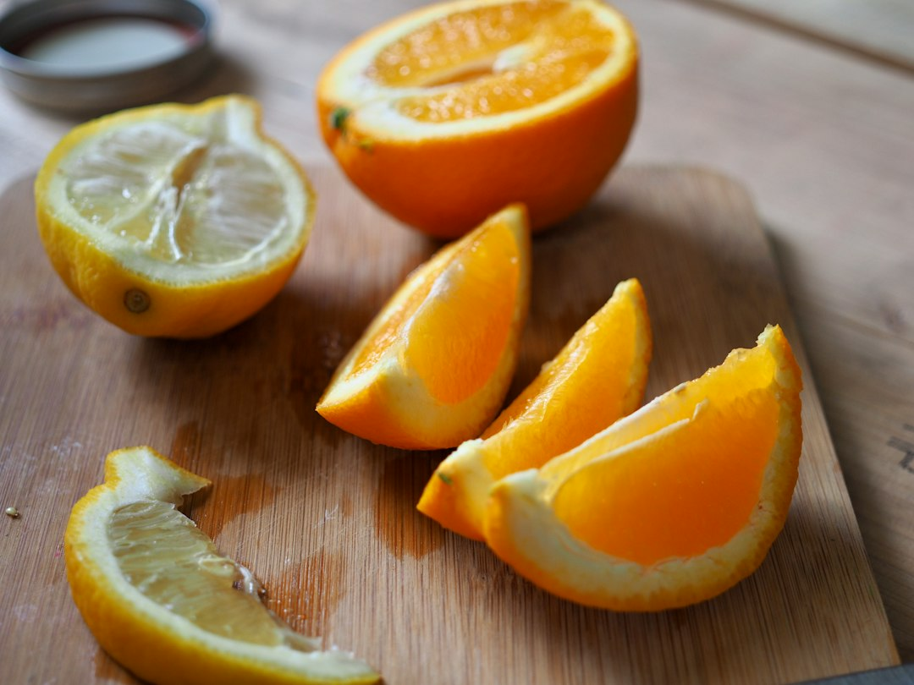

*Photo by [Lucie Rangel](https://unsplash.com/@lucieduci) on [Unsplash](https://unsplash.com)*

You don't need a $150 countertop machine to get fresh lemon juice for your margarita or lime juice for your tacos. Honestly, most of the expensive juicers out there are overkill for citrus. They're built for oranges and grapefruits, and they take up half your counter.

If you're juicing lemons and limes, you need something small, fast, and cheap. Good news: the best citrus juicer for lemons and limes under $18 will handle 95% of what you actually need, and it'll do it in less time than it takes to find your fancy juicer buried in the cabinet.

Let's get into what actually works.

## Why Every Kitchen Needs an Affordable Citrus Juicer

Bottled lemon juice tastes like cleaning product next to the real thing. That sharp, bright acidity you want in a salad dressing or a fish taco only comes from juice you squeezed yourself, five minutes ago. Fresh lime juice in a margarita or guacamole isn't even close to the bottled stuff. Once you taste the difference, you can't go back.

There's also a money angle here. A bottle of lemon juice concentrate runs $4 to $6 and tastes flat after a few weeks open in the fridge. A bag of fresh lemons costs about the same and gives you better flavor, zest for baking, and no preservatives. Buy a cheap juicer once and you'll never buy bottled juice again.

Compact juicers also just make sense for small kitchens. You're not storing a bulky electric orange juicer that you use twice a year. A handheld citrus press or a small reamer fits in a drawer. It weighs nothing. It's ready whenever you need a quick squeeze for a recipe.

Here's the part that surprises people: budget juicers often outperform pricier models for lemons and limes specifically. Expensive juicers are usually optimized for oranges and grapefruits, bigger fruit with different pulp structure. A simple $15 manual press is purpose-built for small citrus. You're not paying for features you don't need, and you're getting a tool that's actually better suited to the job.

## Manual Hand Citrus Juicers Under $18

Manual juicers are about as simple as kitchen tools get. You cut the fruit in half, drop it cut-side down into the press, and squeeze the handles together. The mechanism forces the juice out through small holes while the pulp and seeds stay behind. No electricity, no setup, no noise.

A <a href="https://www.amazon.com/s?k=manual%20hand-held%20citrus%20press%20juicer&tag=merrieri0a-20" data-inline>manual hand-held citrus press juicer</a> is the move if you're juicing one or two pieces of fruit at a time, which honestly covers most home cooking. Need two tablespoons of lime juice for a dressing? This takes fifteen seconds. Making a pitcher of lemonade? It's still faster than digging out an electric machine and plugging it in.

These presses are usually cast aluminum or heavy-duty plastic with an enamel coating, which matters because it resists corrosion from the citric acid over time. Cheap metal presses that aren't coated can pit and discolor after a few months of regular use, so check the material before buying.

Cleanup is a non-issue. Rinse it under hot water right after use and the pulp rinses out easily. Most are dishwasher-safe too, though handwashing extends the life of the hinge mechanism.

When shopping, look for ergonomic handles with some grip texture, since wet hands plus citric acid can make things slippery fast. A non-slip base or a design that lets you rest the press on the counter without it tipping also makes a difference, especially if you're juicing several limes in a row for a big batch of margaritas.

## Electric Citrus Juicers Under $18

If you're juicing citrus more than a couple times a week, or you're making juice in bigger batches, electric starts to make sense. An <a href="https://www.amazon.com/s?k=electric%20countertop%20citrus%20juicer&tag=merrieri0a-20" data-inline>electric countertop citrus juicer</a> in this price range is usually a compact reamer-style unit: you press the fruit down onto a spinning cone and it does the squeezing for you.

The appeal is speed. If you're juicing six lemons for a big batch of lemon bars, or prepping lime juice for a party, electric saves your wrist. These sub-$18 models aren't going to rival a $200 commercial juicer, but for lemons and limes specifically, they get the job done fast.

Power requirements are minimal since citrus is soft and low-resistance compared to something like carrots or beets. Most budget electric citrus juicers run on standard household current with a small motor, nothing special needed. Noise levels are low too, more of a quiet hum than a roar, so it's not going to wake anyone up if you're making juice for breakfast.

The tradeoff with electric is cleanup. More parts means more pieces to wash, and the motor base obviously can't go in the dishwasher. You're also adding counter storage, even if it's small. Manual presses win on simplicity; electric wins on speed and reduced effort when you're processing more fruit.

If you're juicing citrus occasionally for a recipe or two, go manual. If you're making juice regularly, for drinks, dressings, or marinades, several times a week, the electric option earns its spot.

## Stand Juicers vs. Handheld Models: Which Is Best for You

Countertop stand juicers sit on your counter and usually work on a reamer system: you place the citrus half on a ridged cone and press down, sometimes with a lever arm for added leverage. The main advantage is consistency. Every squeeze gets roughly the same pressure, so you get similar yield fruit to fruit.

A <a href="https://www.amazon.com/s?k=stainless%20steel%20citrus%20reamer%20with%20catch%20basin&tag=merrieri0a-20" data-inline>stainless steel citrus reamer with catch basin</a> is a great middle ground here. It's technically handheld in that you're doing the reaming motion yourself, but the built-in basin catches juice and separates seeds without needing a separate bowl underneath. Stainless steel also means it won't react with the acid, won't stain, and won't hold onto smells the way some plastics do over time.

Handheld models, whether it's a reamer or a press, win on storage and portability. You can toss one in a drawer, bring it camping, or keep it in a kitchen bag for potlucks. Stand juicers, even compact ones, need a permanent spot on the counter or in a cabinet, and they're a bit more to dig out for a quick job.

Performance-wise, for lemons and limes, the difference is smaller than you'd think. Both styles extract close to the same amount of juice when used correctly. The real difference is convenience. If you've got counter space and juice citrus daily, a stand model saves repetitive motion. If you're tight on space or only juice occasionally, a handheld press or reamer does the same job without taking up permanent real estate.

Match it to how you actually cook. If you're someone who meal preps dressings and marinades every Sunday, a stand-style setup might earn its keep. If citrus juicing is a once-in-a-while need, like adding lime to tacos or lemon to roasted vegetables, a handheld tool under $18 is all you need.

## Key Features to Compare When Shopping Under $18

Material quality matters more than price tag suggests. Stainless steel resists citric acid corrosion and lasts years. Food-grade plastic is lighter and cheaper but can discolor or crack over time, especially with regular dishwasher use. Silicone splits the difference: it's flexible, doesn't stain, and handles heat and acid well.

Speaking of silicone, a <a href="https://www.amazon.com/s?k=silicone%20manual%20citrus%20juicer&tag=merrieri0a-20" data-inline>silicone manual citrus juicer</a> is worth considering if you want something collapsible for storage or just prefer a soft-grip feel over hard plastic or metal. These tend to be squeeze-style tools that fold flat, which is great if drawer space is tight.

Juice yield is the number one thing to pay attention to. A good design extracts nearly all the juice from a lemon or lime half, leaving behind a dry, flattened rind. Cheap, poorly designed juicers leave a lot of juice behind, which defeats the purpose of buying one in the first place. Look at reviews that specifically mention yield, not just build quality.

Pulp control matters if you like your juice pulp-free for cocktails or smooth for dressings. Reamers and cone-style juicers tend to let more pulp through unless they have a built-in strainer. Press-style juicers with small holes naturally filter out seeds and most pulp.

Dishwasher-safe components save time, but double-check this before assuming. Some budget juicers have coatings or finishes that degrade in the dishwasher even if they're technically "safe." When in doubt, hand wash and air dry.

Size and weight matter for storage and ease of use. A heavier cast metal press gives you more leverage with less effort, but it's bulkier to store. A lightweight plastic or silicone version is easier to tuck away but might require more hand strength for tougher, less ripe citrus.

Warranty is rare at this price point, but some brands still offer a basic 30-day or 90-day guarantee against defects. It's not a dealbreaker if there isn't one, but it's a nice bonus if the option exists.

## Maintenance and Care Tips for Long-Lasting Performance

Rinse your juicer immediately after use. Citric acid residue left to sit can degrade certain metals and plastics over time, and dried pulp gets a lot harder to scrub off once it sits for a few hours. A quick rinse under hot water right after juicing saves you effort later.

For stubborn buildup or any lingering citrus smell, a mix of warm water and a little baking soda works well. Let it soak for a few minutes, then scrub with a soft brush, especially around hinges and ridges where pulp likes to hide.

Mold and odor buildup happen when juicers are put away wet or with pulp residue still stuck in the crevices. Always dry your juicer fully before storing it, and if it has any pulp-catching basin, make sure that's bone dry too. A damp juicer tucked into a dark drawer is basically a mold incubator.

Store it somewhere it won't get crushed under heavier cookware, especially if it's silicone or lightweight plastic. A utensil drawer or a hanging hook works better than the bottom of a deep cabinet.

As for replacement: if a manual press starts leaking around the hinge, or a reamer's spinning cone on an electric model wobbles or stalls, it's time to upgrade. At under $18, these aren't investment pieces meant to last a decade. Expect a good one to serve you well for one to two years of regular use before it's worth replacing.

## FAQ About Budget Citrus Juicers for Lemons and Limes

**What's the difference between a citrus juicer and a regular juicer?**
A citrus juicer is built specifically for the pulp and seed structure of oranges, lemons, and limes, usually using a reamer or press mechanism. Regular juicers, especially masticating or centrifugal models, are designed for harder produce like apples, carrots, or leafy greens and use blades or grinding mechanisms that would be overkill, and kind of wasteful, for something as soft as a lime.

**Can you juice limes as effectively as lemons in budget juicers?**
Yes, limes and lemons are similar enough in size and pulp structure that the same juicer handles both well. Limes are slightly smaller, so if you're using a press-style juicer, make sure the basin size accommodates smaller fruit without the juice missing the catch area. A <a href="https://www.amazon.com/s?k=cone-style%20handheld%20citrus%20juicer&tag=merrieri0a-20" data-inline>cone-style handheld citrus juicer</a> adjusts easily to both sizes since you control the pressure and angle yourself.

**How much juice can you get from one lemon or lime?**
A medium lemon typically yields about 2 to 3 tablespoons of juice. A lime yields slightly less, usually 1 to 2 tablespoons, since limes run smaller on average. A good juicer should get you close to the maximum possible yield; if you're consistently getting less than that, your juicer or your technique might be leaving juice behind. Rolling the fruit firmly on the counter before cutting helps break up the inner membranes and increases yield regardless of which juicer you use.

**Are plastic citrus juicers as good as stainless steel models?**
For occasional use, plastic works fine and costs less. For daily use, stainless steel holds up better against the acid over time and won't discolor or develop a slight smell the way some plastics eventually do. If you're juicing citrus every day, spend the extra couple dollars for steel. If it's a once-a-week tool, plastic or silicone is perfectly fine.

**Do budget juicers under $18 really save money compared to buying bottled juice?**
Yes, pretty quickly. A bag of 5 to 6 limes costs about the same as a bottle of lime juice concentrate, but fresh limes give you noticeably better flavor and you can also use the zest for cooking and baking. Since the juicer itself is a one-time cost under $18, it pays for itself within the first few uses just from the flavor upgrade alone, not even counting long-term savings.

If you're setting up a kitchen station for drinks or meal prep, pairing your juicer with the right tools makes a difference too. A solid cutting board with a [juice groove](https://kitchen-finds.com/2026/11/11/best-bamboo-cutting-boards-with-juice-groove-under-25-in-2026-top-picks-for-every-kitchen/) catches any juice that escapes while you're halving your citrus, which saves your counter from sticky runoff. And if you're making dressings or marinades right after juicing, a decent set of [stainless mixing bowls](https://kitchen-finds.com/2026/11/13/best-stainless-steel-mixing-bowls-under-40-in-2026-top-picks-for-every-kitchen/) makes whisking everything together a lot easier than trying to balance a small bowl while you work.

For people who want options without overthinking it, a <a href="https://www.amazon.com/s?k=two-in-one%20citrus%20juicer%20with%20adjustable%20cones&tag=merrieri0a-20" data-inline>two-in-one citrus juicer with adjustable cones</a> handles both lemons and limes (and oranges, in a pinch) without needing separate tools for each size. And if you're someone who travels or juices citrus away from a standard kitchen setup, like at a cabin or on a boat, a <a href="https://www.amazon.com/s?k=portable%20battery-operated%20citrus%20juicer&tag=merrieri0a-20" data-inline>portable battery-operated citrus juicer</a> gives you electric convenience without needing to be near an outlet.

At the end of the day, the best citrus juicer for lemons and limes under $18 is the one that matches how you actually cook. If you're squeezing a lime for guacamole twice a week, don't overthink it, grab a simple press and move on with your life. If you're making pitchers of lemonade or margaritas for a crowd, spend the extra few dollars on an electric option and save your hands the work. Either way, fresh juice is cheap, fast, and genuinely better than anything that comes in a bottle.

## Related Articles

- [Best Microwave Egg Cooker for Quick Breakfast Under $15 in 2026 | Top Picks & Reviews](https://kitchen-finds.com/2026/11/18/best-microwave-egg-cooker-for-quick-breakfast-under-15-in-2026-top-picks-reviews/)
- [Best Stainless Steel Mixing Bowls Under $40 in 2026: Top Picks for Every Kitchen](https://kitchen-finds.com/2026/11/13/best-stainless-steel-mixing-bowls-under-40-in-2026-top-picks-for-every-kitchen/)
- [Best Bamboo Cutting Boards with Juice Groove Under $25 in 2026: Top Picks for Every Kitchen](https://kitchen-finds.com/2026/11/11/best-bamboo-cutting-boards-with-juice-groove-under-25-in-2026-top-picks-for-every-kitchen/)
