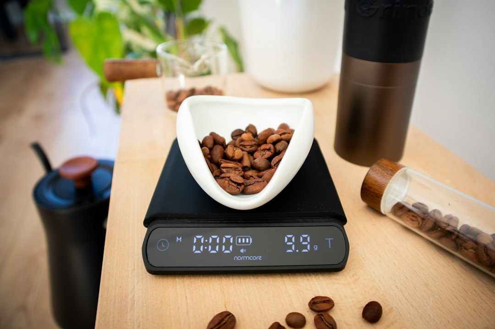

*Photo by [User_Pascal](https://unsplash.com/@user_pascal) on [Unsplash](https://unsplash.com)*

If you've ever eyeballed a "serving size" of pasta and ended up with enough for three people, you know why portion control without a scale is basically a guessing game. Measuring cups lie. Your eyes lie even more. The only honest tool in your kitchen is a scale that tells you exactly how many grams of chicken, rice, or almond butter you're actually dealing with.

The good news is you don't need to spend a fortune to get lab-grade accuracy. Some of the best kitchen scales for portion control sit comfortably under $50, and a few even under $15. I tested and researched both picks below for accuracy, ease of cleaning, and whether they actually hold a calibration over time instead of drifting after a few months of daily use.

By the end of this, you'll know exactly which three fits your counter space, your cooking habits, and your budget.

## Quick Picks

- **Best overall:** Tcsxady Food Scale: a more precise sensor than most budget scales, in a slim design that tucks into a drawer instead of hogging counter space.
- **Best value and most trusted:** Etekcity Food Kitchen Scale: holds its calibration for years and handles an 11 lb load, which is why it's stayed a bestseller this long.

## Comparison Table

| Product | Best For | Capacity | Key Perk |
|---|---|---|---|
| Tcsxady Food Scale | Flexible, everyday portioning | N/A | Lab-grade accuracy sensor |
| Etekcity Food Kitchen Scale | Home and light commercial use | 11 lb | Simple, reliable tare function |

## How We Picked These

We looked for scales under $50 that prioritize gram-level accuracy over gimmicky extras, since portion control lives and dies by precision. We weighted ease of cleaning, tare function reliability, and display readability heavily, because a scale you can't read clearly in a dim kitchen is useless at 7 a.m. We also factored in real owner feedback on long-term calibration drift, not just out-of-the-box specs.

## The Best Kitchen Scales for Portion Control Under $50

### Tcsxady Food Scale, Digital Kitchen Scale

This one solves the classic problem of cheap scales giving you wildly different readings for the same item weighed twice. It's built with a more refined sensor than most budget scales, so if you're tracking macros or following a strict portioning plan, you're not second-guessing every number on the display. The flexible design also makes it easy to tuck away in a drawer instead of leaving it as permanent counter clutter.

**Best for:** people who track macros or follow strict portion plans and need numbers they can actually trust.

**Pros:**
- Consistent, repeatable readings across multiple weigh-ins, so you're not reweighing the same item three times to double-check
- Compact enough to store flat in a drawer instead of taking up counter space
- Simple interface with minimal button-fumbling, no manual required to tare and switch units

**Cons:**
- Smaller platform may feel tight for bulkier items like a whole roast or a mixing bowl
- Instructions could be clearer for first-time users, the manual glosses over the unit-switching steps

[→ Check price on Amazon](https://www.amazon.com/dp/B0HHWWXCN3?tag=merrieri0a-20)

### Etekcity Food Kitchen Scale, Digital Grams and Ounces, 11lb

The Etekcity solves the "will this thing still work in a year" problem that plagues so many budget scales. It's been a go-to for home cooks and small food businesses alike because the build quality and consistent calibration hold up well past the first few months. With an 11 lb capacity, it comfortably handles everything from a single chicken breast to a full batch of cookie dough.

**Best for:** anyone who wants a dependable, long-lasting scale without paying for extra features they won't use.

**Pros:**
- 11 lb capacity handles both small portions and bulk ingredients, so you don't need a second scale for baking day
- Switches easily between grams and ounces, handy when a recipe lists one and your tracking app wants the other
- Durable build that holds calibration over time instead of drifting after a few months of daily use

**Cons:**
- Platform surface shows fingerprints and needs regular wiping to stay presentable
- No backlight makes it harder to read the display in a dim kitchen

[→ Check price on Amazon](https://www.amazon.com/dp/B0113UZJE2?tag=merrieri0a-20)

## What to Skip

- Avoid scales with a platform smaller than 5 inches across. They look sleek but make weighing bowls or larger cuts of meat frustrating.
- Skip scales that only measure in whole grams. If you're doing serious portion control, you want at least one decimal of precision for things like supplements or spices.
- Don't buy a scale without a visible tare button. Having to subtract bowl weight manually defeats the entire purpose of a digital scale.

## Frequently Asked Questions

**Do I need a food scale for portion control if I already use measuring cups?**
Measuring cups are fine for consistency in baking, but they're unreliable for portion control because volume doesn't equal weight. A cup of chopped vegetables can vary by 30% or more depending on how tightly it's packed, while a scale gives you an exact number every time.

**What's the most accurate type of kitchen scale under $50?**
Scales with a strain gauge sensor, like both options featured here, tend to offer the best accuracy at this price point. Look for one that measures in 1-gram increments rather than 5-gram jumps if you're portioning small items like nuts or medication doses.

**How often should I calibrate a budget kitchen scale?**
Most budget scales should be checked every few months using a known weight, like a stack of coins or a calibration weight set. If the readings start drifting by more than a gram or two, it's time to recalibrate or consider replacing the scale.

## The Bottom Line

Both the Tcsxady and Etekcity scales deliver accurate, dependable portion control without breaking a $50 budget. If you want sharper precision for tracking macros, go with the Tcsxady. If you want a durable all-rounder that's been proven over years of daily use, the Etekcity is the safer bet.

---

## Related Articles

- [Best Citrus Juicer for Lemons and Limes Under $18 in 2026: Top Budget-Friendly Options](https://kitchen-finds.com/2026/11/20/best-citrus-juicer-for-lemons-and-limes-under-18-in-2026-top-budget-friendly-options/)
- [Best Microwave Egg Cooker for Quick Breakfast Under $15 in 2026 | Top Picks & Reviews](https://kitchen-finds.com/2026/11/18/best-microwave-egg-cooker-for-quick-breakfast-under-15-in-2026-top-picks-reviews/)
- [Best Toaster Oven for a Studio Apartment Under $4 (2024 Picks)](https://kitchen-finds.com/2026/11/16/best-toaster-oven-for-a-studio-apartment-under-50/)