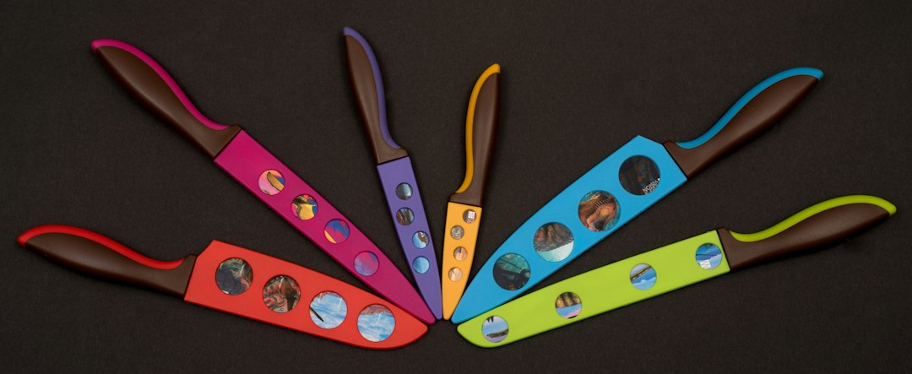

*Photo by [Chef's Vision](https://unsplash.com/@chefsvision) on [Unsplash](https://unsplash.com)*

That pickle jar isn't going to open itself, and if you've got arthritis, carpal tunnel, or just tired hands after a long day, fighting with a stuck lid is nobody's idea of fun. The good news? You don't need a fancy electric gadget or a trip to the ER to get that jar open. A simple silicone jar opener, the kind that costs less than your morning coffee run, can turn a two-handed, red-faced struggle into a five-second task.

I've tested a bunch of these over the past year, mostly because my own grip strength isn't what it used to be after a wrist injury. Here's everything I've learned about finding the best silicone jar opener for weak grip under $12, plus the specific products that actually deliver.

## Why Silicone Jar Openers Are Perfect for Weak Grip Strength

Silicone isn't just a trendy material slapped on kitchen tools because it looks nice. It actually does something mechanical that other materials can't.

### How silicone provides better traction than metal

Metal jar openers rely on teeth or ridges to bite into the lid. That works fine if you have the hand strength to clamp down hard. But metal is rigid. It doesn't flex or mold around the lid shape, so you're still doing most of the work yourself.

Silicone behaves differently. It's tacky, slightly soft, and conforms to whatever surface it touches. When you wrap a silicone opener around a lid and twist, the material grips the metal or glass through friction, not force. You don't need to squeeze hard. The silicone does that part for you. This is the entire reason silicone has become the go-to material for anyone searching for the best silicone jar opener for weak grip under $12 instead of just grabbing whatever opener is cheapest.

### Ergonomic benefits for arthritis and hand weakness

If you've got arthritis, you already know the drill: swollen knuckles, stiff joints, and pain that flares up the moment you try to apply pressure. Traditional jar openers often make this worse because they require a pinching or twisting motion that puts direct stress on inflamed joints.

Silicone openers are designed around a different kind of motion. Most use a flat palm-press or wrap-around grip, which spreads the force across your whole hand instead of concentrating it in your fingers. That's a big deal if finger joints are where your pain lives.

### Why traditional openers fail for people with limited grip strength

Rubber jar grippers from the 90s, the thin rubber discs your grandma kept in a drawer, dry out and harden over time. Metal openers with teeth require a firm clamping grip to even stay in place, which defeats the purpose if your hands are the problem to begin with. Plastic openers crack under pressure and often just slip right off a greasy lid.

The common failure point across all of these is that they assume you have strength to spare. Silicone openers assume the opposite, and they're built to compensate.

### Durability and longevity compared to other materials

Silicone doesn't dry out, crack, or go brittle the way rubber does. It holds up to heat (so if you accidentally toss it in the dishwasher, no big deal), and it resists the kind of wear that makes other grip-assist tools useless after six months. A good silicone opener under $12 can realistically last years with basic care.

## Key Features to Look For in a Budget Silicone Jar Opener

Not all silicone openers are created equal, even at this price point. Here's what separates the good ones from the ones that'll frustrate you more than the jar did.

### Grip comfort and handle design

Look for a handle with some thickness to it, not a thin strip of silicone. Thicker material means less finger pressure needed to hold it in place. Cushioned or contoured handles that match the shape of your palm are a big upgrade over flat, one-size-fits-all designs.

### Universal sizing and compatibility

The best options stretch or flex to accommodate different lid diameters, from small spice jars to big pickle jars. If a product only works on one size, you're going to end up buying three different openers, which defeats the whole "under $12" budget goal.

### Non-slip surface technology

This is where textured patterns matter. Raised dots, ridges, or honeycomb patterns on the silicone surface increase friction even further. Smooth silicone works okay, but textured silicone works a lot better, especially on wet or oily jar lids.

### Ease of storage and cleaning

Flat, flexible designs that can hang on a hook or lie flat in a drawer win here. Most are dishwasher safe, but even hand washing silicone takes about ten seconds because food doesn't stick to it the way it does to rubber.

### Warranty and durability guarantees

A lot of budget kitchen tools don't bother with warranties, but some sellers in this category do offer replacements if the product cracks or loses grip prematurely. It's worth checking the listing before buying, since a one-year guarantee on a $10 product is basically free insurance.

## Top Silicone Jar Openers Under $12 for 2026

Here's where I get specific. These are the products actually worth buying right now, based on grip performance, durability, and user feedback.

### 1. Universal grip silicone jar opener

This is the classic flat-disc style opener, and it's a solid starting point if you've never used one before. You lay it over the lid, press down with your palm, and twist. The flexible material stretches to fit jars from small jam containers to large mayo jars. This <a href="https://www.amazon.com/s?k=universal%20silicone%20grip%20jar%20opener&tag=merrieri0a-20" data-inline>universal silicone grip jar opener</a> is a reliable all-rounder that doesn't require a learning curve.

### 2. Non-slip rubber band style opener

Think of this as a stretchy loop that wraps fully around the lid rather than just covering the top. The wraparound design means more surface contact, which translates to more grip without more hand effort. If you've got weaker hands and need something that locks on rather than something you have to hold in place, this <a href="https://www.amazon.com/s?k=non-slip%20rubber%20band%20style%20jar%20opener&tag=merrieri0a-20" data-inline>non-slip rubber band style jar opener</a> is worth a look.

### 3. Ergonomic handle silicone jar opener

This style adds a molded handle to the equation, so instead of just pressing your palm flat, you get something shaped to hold onto. It's especially good for people with arthritis because it reduces the pinching motion. The <a href="https://www.amazon.com/s?k=ergonomic%20cushioned%20handle%20jar%20opener&tag=merrieri0a-20" data-inline>ergonomic cushioned handle jar opener</a> distributes pressure across your whole hand instead of your fingertips, which makes a noticeable difference if joint pain is your main obstacle.

### 4. Textured silicone grip opener

Texture is everything when a lid is even slightly greasy or wet, which happens more than you'd think with pickle jars and olive oil containers. This option uses raised ridges across the entire gripping surface. The <a href="https://www.amazon.com/s?k=textured%20silicone%20screw%20cap%20opener&tag=merrieri0a-20" data-inline>textured silicone screw cap opener</a> handles screw-top lids especially well, since the texture bites into the ridged metal rim without needing extra force from you.

### 5. Multi-function silicone opener with built-in features

Some of these openers do double duty, working as a trivet or a jar opener depending on which side you use. It's a nice bonus if you're trying to keep kitchen clutter down. The <a href="https://www.amazon.com/s?k=multi-purpose%20silicone%20opener%20tool&tag=merrieri0a-20" data-inline>multi-purpose silicone opener tool</a> is a good pick if you want one tool that earns its drawer space a couple different ways.

### 6. Silicone screw cap opener with wide grip

Wide-grip designs give your whole palm something substantial to press against, which matters a lot if your fingers tire out quickly. The extra surface area means you can apply even pressure without needing pinpoint finger strength. The <a href="https://www.amazon.com/s?k=wide%20palm%20silicone%20jar%20opener&tag=merrieri0a-20" data-inline>wide palm silicone jar opener</a> is built specifically with this wider design in mind, and it's one of the easier options to use one-handed if you're bracing the jar against a counter.

### 7. Cushioned silicone jar opener

This style prioritizes comfort above all else, with a soft, slightly padded surface that doesn't dig into your palm even with repeated use. If you're opening multiple jars in one cooking session (meal prepping, canning, whatever), hand fatigue becomes the real issue, and a cushioned grip helps a lot. The <a href="https://www.amazon.com/s?k=soft-grip%20silicone%20lid%20opener&tag=merrieri0a-20" data-inline>soft-grip silicone lid opener</a> holds up well here.

## How to Use a Silicone Jar Opener Effectively

Owning the right tool is only half the equation. Technique matters too, especially when grip strength is limited.

### Proper hand positioning for maximum leverage

Place the opener so it covers as much of the lid surface as possible. For disc-style openers, center your palm directly over the middle of the lid rather than off to one side. This keeps the twisting force even instead of concentrated on one edge, which reduces slipping.

### Technique for opening stubborn jars

For really stuck lids, try running warm water over the lid for 20 to 30 seconds first. Heat expands metal slightly faster than glass, which loosens the seal. Then apply your silicone opener and twist in one steady motion rather than short, jerky attempts. Short bursts tend to just re-tighten the seal.

Bracing the jar against your body or a non-slip counter mat also helps a ton, since it means your other hand isn't working as hard to hold the jar still.

### Safety tips for people with weak grip strength

Never twist using just your fingertips, even with a silicone opener in hand. Use your whole palm and engage your forearm, not just your wrist. If a jar genuinely won't budge after a couple of tries, stop and try the warm water trick rather than forcing it repeatedly, which can aggravate joint pain.

### How to protect your hands during use

If you're dealing with arthritis flare-ups, avoid prolonged gripping sessions. Open what you need, then rest. A lot of people make the mistake of opening every jar in the pantry in one go because the tool makes it "easy," then overdo it and pay for it later.

## Silicone vs. Other Jar Opener Materials Under $12

### Silicone compared to rubber grips

Rubber grips were the standard for decades, but rubber degrades. It hardens, cracks, and loses tackiness within a year or two of regular use. Silicone stays flexible far longer and doesn't develop that stiff, slippery surface rubber gets once it ages.

### Silicone vs. metal openers

Metal openers with teeth can actually scratch glass lids and need significant hand strength to clamp down, which is the opposite of what someone with weak grip needs. Silicone wins here on almost every front except raw durability against extreme force, which honestly isn't a factor for home kitchen use.

### Silicone vs. plastic alternatives

Plastic jar openers are usually the cheapest option you'll find, but they also crack the fastest and offer the least amount of actual friction. Silicone costs maybe a dollar or two more but lasts years longer and performs significantly better on the first try, not just when it's brand new.

### Cost-effectiveness and value for money

At under $12, a quality silicone opener is one of the best value purchases in the kitchen tool category. Compare that to electric jar openers that run $20 to $40 and require counter space, batteries, or charging. For most people, especially those just dealing with moderate grip weakness rather than full hand mobility loss, a simple silicone opener gets the job done for a fraction of the price and complexity.

If you're setting up a kitchen that's generally easier on your hands, it's also worth checking out tools like a good [citrus juicer](https://kitchen-finds.com/2026/11/20/best-citrus-juicer-for-lemons-and-limes-under-18-in-2026-top-budget-friendly-options/) that doesn't require heavy squeezing, or [silicone squeeze bottles](https://kitchen-finds.com/2026/11/06/best-silicone-squeeze-bottles-for-condiments-under-20-in-2026-top-picks-for-your-kitchen/) that cut down on twist-cap frustration for condiments you use daily.

## FAQ

**What makes silicone jar openers better for weak grip strength?**
Silicone grips through friction and flexibility rather than requiring you to apply strong clamping force. The material molds around the lid shape and does a lot of the gripping work on its own, so your hands don't have to.

**Can silicone jar openers open all jar sizes under $12?**
Most budget silicone openers are designed to stretch or flex across a range of sizes, typically handling anything from small spice jars to large pickle or mayo jars. A few specialty designs are sized for specific lid diameters, so check the product description if you regularly deal with unusually large or small jars.

**How long do silicone jar openers last before needing replacement?**
With normal use and basic cleaning, a quality silicone opener can last two to three years or longer. Unlike rubber, silicone resists cracking and hardening, so it typically keeps working well past when cheaper materials would've failed.

**Are silicone jar openers dishwasher safe?**
Most are, since silicone handles heat well without warping or melting. That said, it's worth checking the specific product listing, since a small number of designs combine silicone with other materials that may need hand washing.

**What's the difference between a universal silicone opener and a specialized one?**
Universal openers are built to flex and stretch across a wide range of jar sizes, making them a good one-tool solution for most kitchens. Specialized openers, like screw-cap specific designs or wide-palm versions, are optimized for a particular use case, like stubborn screw-top lids or users who need extra surface area due to limited finger strength. If you only want to buy one opener, go universal. If you deal with a specific type of jar often (olive oil bottles, pickle jars, whatever), a specialized option might perform better for that exact task.

## Related Articles

- [Best Citrus Juicer for Lemons and Limes Under $18 in 2026: Top Budget-Friendly Options](https://kitchen-finds.com/2026/11/20/best-citrus-juicer-for-lemons-and-limes-under-18-in-2026-top-budget-friendly-options/)
- [Best Microwave Egg Cooker for Quick Breakfast Under $15 in 2026 | Top Picks & Reviews](https://kitchen-finds.com/2026/11/18/best-microwave-egg-cooker-for-quick-breakfast-under-15-in-2026-top-picks-reviews/)
- [Best Stainless Steel Mixing Bowls Under $40 in 2026: Top Picks for Every Kitchen](https://kitchen-finds.com/2026/11/13/best-stainless-steel-mixing-bowls-under-40-in-2026-top-picks-for-every-kitchen/)
