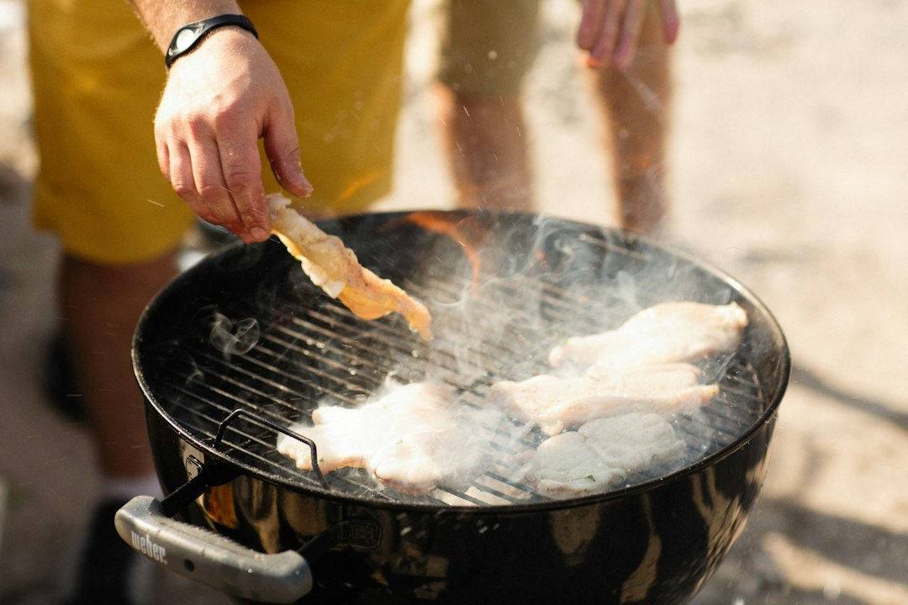

*Photo by [Alexey Demidov](https://unsplash.com/@alexeydemidov) on [Unsplash](https://unsplash.com)*

## Why Every Home Cook Needs a Quality Basting Brush Set

You know that moment when you're glazing ribs on the grill and your brush starts shedding bristles onto the meat? Or when your only "pastry brush" is really just a stiff paintbrush from the garage that leaves streaks on your pie crust? That's the gap a decent basting brush set fills.

A good basting brush set works double duty. Use it to mop barbecue sauce on chicken thighs over direct heat, then wash it and use the same brush (or a softer one from the same set) to brush egg wash on a batch of croissants the next morning. That's the real value here: one purchase covers grilling season and baking season without you owning six different brushes scattered across three drawers.

Buying individual brushes one at a time adds up fast. A single silicone basting brush at a kitchen store can run $8 to $12 on its own. A set gives you two, three, sometimes four brushes with different bristle types and sizes for less than what you'd pay for a single premium brush elsewhere. That's just smarter shopping.

The best basting brush set for grilling and baking under $16 isn't hard to find once you know what separates a brush that lasts years from one that melts onto your grill grates after one cookout. Heat resistance, bristle material, and handle construction matter more than brand names here. Let's get into what actually counts.

## What to Look For in a Basting Brush Set Under $16

### Bristle Material Options

Silicone bristles dominate the grilling space for good reason. They don't absorb grease, they wipe clean in seconds, and they handle high heat without melting or shedding. The tradeoff is that silicone doesn't hold thin liquids like egg wash as well as natural bristles do, so for delicate pastry work, silicone can feel a bit clumsy.

Natural bristle brushes, usually boar hair or similar, soak up liquid and release it evenly. That makes them the go-to for egg washes, butter on phyllo dough, and glazes where you want a thin, even coat rather than a thick streak. The downside is they're harder to clean thoroughly and they're not built for direct grill heat.

Nylon sits in the middle. Heat-resistant nylon bristles can handle moderate grill temps and clean up easier than natural bristles, though they still can't match silicone's total indifference to heat and grease.

### Handle Durability and Comfort

Wooden handles look nice and feel solid in your hand, but they need to be sealed well or they'll crack after repeated dishwasher cycles. Stainless steel handles cost a little more to produce but survive heat, moisture, and years of use without warping. Plastic handles are the budget default and work fine as long as the plastic is food-grade and doesn't get brittle near heat sources.

### Heat Resistance Ratings

For grilling, you want bristles rated for at least 450°F. Most silicone sets on the market handle up to 600°F, which covers direct grill heat with room to spare. Always check the actual rating rather than assuming "silicone equals heatproof," because cheaper silicone blends can soften below 400°F.

### Cleaning Ease and Dishwasher Compatibility

Silicone and nylon brushes are almost always dishwasher safe. Natural bristle brushes typically need hand washing because dishwasher heat and detergent break down the bristles and loosen the glue holding them to the handle. If you hate hand washing kitchen tools, prioritize sets with full dishwasher compatibility.

### Number of Brushes Included

Budget sets under $16 usually include two to four brushes. More isn't always better here. A set of two well-made brushes beats a set of five flimsy ones that all fall apart at the same rate. Look for variety in bristle type and head size rather than just quantity.

## Top Basting Brush Sets for Grilling Under $16

Grilling puts brushes through the toughest test: direct flame, dripping grease, and repeated dunking in marinade. Silicone wins here almost every time.

A <a href="https://www.amazon.com/s?k=silicone%20basting%20brush%20set%20with%20wooden%20handles&tag=merrieri0a-20" data-inline>silicone basting brush set with wooden handles</a> hits a sweet spot for grill season. The silicone heads shrug off heat and clean up with a quick rinse, while the wooden handle keeps things from feeling too plasticky in your hand. Just don't leave them soaking in the sink, since standing water is what eventually damages the wood-to-silicone seal.

If you want something built purely for heat tolerance, a <a href="https://www.amazon.com/s?k=heat-resistant%20nylon%20grill%20brush%20set&tag=merrieri0a-20" data-inline>heat-resistant nylon grill brush set</a> is worth a look. Nylon bristles flex well around grates and drumsticks, and they tend to hold more sauce per dip than silicone, which means fewer trips back to the bowl while you're standing over hot coals.

For cooks who want a sturdier build that won't wobble or loosen after a season of use, a <a href="https://www.amazon.com/s?k=stainless%20steel%20handle%20basting%20brush%20set&tag=merrieri0a-20" data-inline>stainless steel handle basting brush set</a> is the most durable option in this price range. Steel handles don't crack, don't absorb odors, and they survive dishwasher cycles indefinitely. If you grill often, durability like this pays off within a single summer.

Customer feedback across these budget categories tends to repeat the same themes: people are happy when bristles stay attached after repeated use, and they complain loudly when heads melt or handles crack after a few cookouts. Sticking with silicone or nylon rated for high heat avoids most of these complaints. If you're also upgrading your grilling station, a solid [cutting board with a juice groove](https://kitchen-finds.com/2026/11/11/best-bamboo-cutting-boards-with-juice-groove-under-25-in-2026-top-picks-for-every-kitchen/) pairs well for prepping meat before it hits the grates.

## Best Basting Brush Sets for Baking and Pastry Work Under $16

Baking asks something different from your brush. You're not fighting flame, you're trying to lay down a thin, even layer of egg wash, melted butter, or glaze without tearing delicate dough.

A <a href="https://www.amazon.com/s?k=natural%20bristle%20pastry%20brush%20set&tag=merrieri0a-20" data-inline>natural bristle pastry brush set</a> is built exactly for this. The bristles hold liquid in a way silicone simply can't replicate, which means smoother coverage on croissants, pie crusts, and tart shells. The brush glides instead of smearing, and that's the difference between a bakery-style golden crust and a streaky, uneven one.

Bristle softness matters a lot for egg wash and glazing work specifically. Stiffer bristles can drag through delicate laminated dough and ruin the layers you worked to build. Natural bristle sets in this price range usually come in a couple of widths, a wider brush for coating full sheets of dough and a narrower one for detail work like glazing the edges of hand pies or brushing butter between layers of baklava.

For decorative work, like dusting powdered sugar patterns, applying food coloring accents, or doing fine egg wash lines on bread for a bakery look, a slim natural bristle brush gives you far more control than anything silicone. Professional pastry brushes used in bakeries cost quite a bit more, often $20 to $30 for a single brush, but the bristle quality and control you get from a budget natural bristle set holds up surprisingly well for home use. You're not running a commercial kitchen, so the gap in performance is smaller than the gap in price.

If you're baking often, it's also worth having solid prep tools around. A good set of [stainless steel mixing bowls](https://kitchen-finds.com/2026/11/13/best-stainless-steel-mixing-bowls-under-40-in-2026-top-picks-for-every-kitchen/) makes whisking egg wash and mixing glazes a lot less messy than working out of a single bowl that's too small.

## Multi-Purpose Sets That Excel at Both Grilling and Baking

If you don't want to own two separate sets, there's a middle path, and it's a good one.

A <a href="https://www.amazon.com/s?k=mixed%20bristle%20multi-purpose%20basting%20set&tag=merrieri0a-20" data-inline>mixed bristle multi-purpose basting set</a> typically pairs a silicone brush for grilling tasks with a softer bristle brush for baking, all in one package under $16. This is genuinely the best basting brush set for grilling and baking under $16 if you want one purchase to cover both seasons without compromise. You get the heat resistance where you need it and the fine control where you need that instead.

Design matters here too. An <a href="https://www.amazon.com/s?k=angled%20silicone%20basting%20brush%20collection&tag=merrieri0a-20" data-inline>angled silicone basting brush collection</a> solves a problem a lot of straight brushes have: getting into corners of a baking dish or reaching around a whole chicken on the grill. The angled head lets you apply sauce or glaze at better angles without bending your wrist awkwardly, which matters more than people expect once you're twenty minutes into a long grilling session.

Ergonomics matter for hand size too. Thicker handles work better for larger hands or when your hands are wet and greasy from marinade. Thinner handles give more control for detail baking work. The best multi-purpose sets include a mix of handle widths so everyone in the house finds something comfortable.

For overall value, a mixed set wins on flexibility, but if you grill way more than you bake (or vice versa), buying a dedicated set for your primary use case gives you better performance where it counts. There's no wrong answer, just a question of how you actually cook.

## How to Maximize Your Basting Brush Set's Lifespan

Cleaning technique depends entirely on bristle material. Silicone brushes can go straight into the dishwasher or get a quick scrub with soap and hot water. Grease slides off silicone easily, so don't overthink it.

Natural bristle brushes need gentler treatment. Hand wash with mild soap, squeeze out excess water gently (don't wring), and let them air dry bristle-side down so water doesn't pool at the base and loosen the glue. Never put natural bristle brushes in the dishwasher. The heat and detergent will destroy them within a few cycles.

Storage matters more than people think. Lay brushes flat or hang them bristle-side down. Storing them bristle-side up in a drawer traps moisture at the base and invites mildew, especially with natural bristles. A simple utensil crock on the counter works well for air circulation.

Know when to retire a brush versus the whole set. If one brush in your set starts shedding bristles or the head feels loose on the handle, replace just that brush if it's sold separately, or keep using the rest of the set until more pieces wear out. Full replacement only makes sense once most of the set shows wear at the same time, which usually happens around the one to two year mark with regular use.

Heat-resistant bristles hold up best when you avoid leaving them directly on hot grates for extended periods. Dip, brush, and pull back rather than resting the brush head on the grill while you tend to something else. This single habit extends bristle life more than any cleaning routine.

## FAQ: Common Questions About Basting Brush Sets Under $16

**What's the difference between silicone and natural bristle brushes for grilling?**

Silicone handles high heat without melting or shedding and cleans up in seconds. Natural bristles can singe or burn near direct flame and tend to hold onto grease and odor over time. For grilling specifically, silicone is the safer, longer-lasting choice.

**Can I use a basting brush set in the dishwasher?**

Silicone and nylon brushes, yes, almost always. Natural bristle brushes, no. Check the product listing or packaging, but as a general rule, if the bristles are made from hair rather than synthetic material, hand wash only.

**How many brushes do I actually need in a set?**

Two solid brushes cover most households: one silicone for grilling and sauces, one natural bristle for baking and glazing. Sets with three or four brushes give you more size options, which helps if you bake often and need both a wide brush for sheets of dough and a narrow one for detail work.

**Are cheap basting brush sets worth buying or will they fall apart?**

Price alone doesn't predict durability. A $14 silicone set with solid construction will outlast a $25 set with weak bristle attachment. Focus on material quality and heat ratings rather than price point, and you'll find plenty of basting brush sets for grilling and baking under $16 that last for years.

**What's the best brush size for different grilling and baking tasks?**

Wider brushes (1.5 to 2 inches) work best for covering large surfaces fast, like basting a whole chicken or coating a sheet of puff pastry. Narrower brushes (under an inch) give you control for detail work like glazing pastry edges or brushing butter into tight corners of a baking dish. A good set gives you both widths rather than forcing you to pick one.

Basting brushes are one of those tools that seem minor until you're standing over a hot grill with a brush that's melting in your hand, or trying to glaze a pie with bristles that leave streaks everywhere. Spending a little time picking the right set, rather than grabbing whatever's cheapest at the store, means you won't be shopping for a replacement halfway through summer. Whether you land on silicone, natural bristle, or a mixed set that covers both jobs, the best basting brush set for grilling and baking under $16 is out there, and it's worth getting right the first time. For something compact enough to toss in a cooler bag or take camping, a <a href="https://www.amazon.com/s?k=compact%20travel%20basting%20brush%20set&tag=merrieri0a-20" data-inline>compact travel basting brush set</a> rounds things out nicely if you grill away from home as much as in your own backyard.

## Related Articles

- [Best Silicone Jar Opener for Weak Grip Under $12 in 2026 – Top Picks & Reviews](https://kitchen-finds.com/2026/11/25/best-silicone-jar-opener-for-weak-grip-under-12-in-2026-top-picks-reviews/)
- [Best Citrus Juicer for Lemons and Limes Under $18 in 2026: Top Budget-Friendly Options](https://kitchen-finds.com/2026/11/20/best-citrus-juicer-for-lemons-and-limes-under-18-in-2026-top-budget-friendly-options/)
- [Best Microwave Egg Cooker for Quick Breakfast Under $15 in 2026 | Top Picks & Reviews](https://kitchen-finds.com/2026/11/18/best-microwave-egg-cooker-for-quick-breakfast-under-15-in-2026-top-picks-reviews/)
